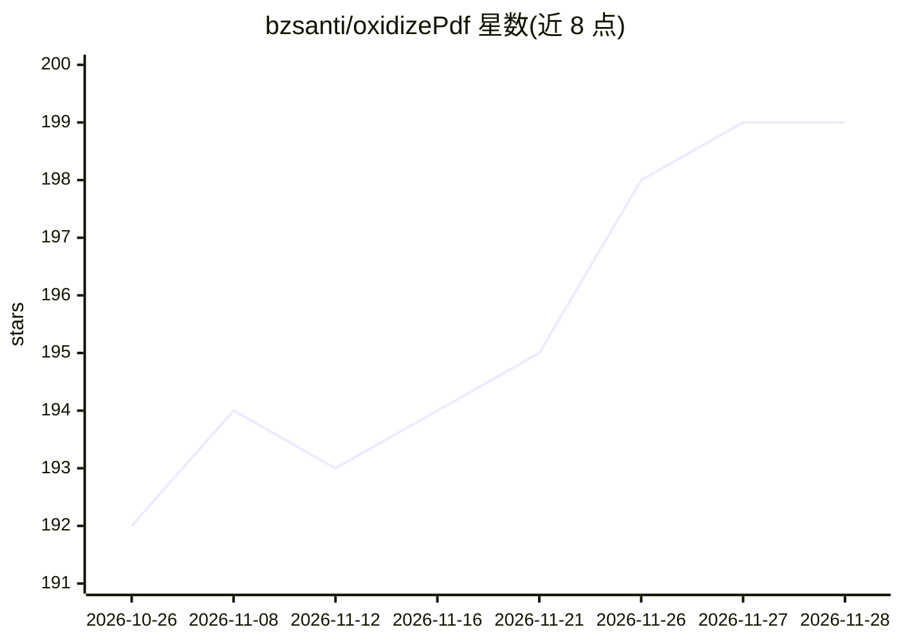

# bzsanti/oxidizePdf

⭐ 199 · Rust · MIT · 推送 2026-11-16 · [GitHub](https://github.com/bzsanti/oxidizePdf) · [官网](https://bzsanti.github.io/oxidizePdf/) · 个人维护

**为 AI/RAG 管道提供结构感知 PDF 分块的纯 Rust 库**

纯 Rust 实现的 PDF 工具箱：生成、解析、修改、提取与验证 PDF，无需 C 绑定。在常规 PDF 功能之外，rag_chunks 接口把文档切分为带页码、边界框、元素类型、标题上下文与 token 估算的元数据分块，供向量库摄取；Contextual Retrieval 采用无 ML 的确定性前缀方案，不调用 LLM 或 GPU。还提供 PDF/A 校验、数字签名检测与 PKCS#7 验证、加密读写、发票提取（ES/EN/DE/IT）等。限制：不做页面栅格化，证书式收件人加密不支持。

## 筛选速览

| 维度 | 判定 | 备注 |
|---|---|---|
| AI 角色 | `ai-enhanced` | 去掉 AI 部分产品仍成立 |
| 许可风险 | `permissive` | MIT |
| 部署形态 | `library` | 以包/库形式分发 |
| 模型依赖 | — | README 未给出锁定关系 |
| 硬件要求 | — | 无带数字的原话,不猜 |
| 安装摩擦 | `low` | 无编译、无系统依赖或容器化 |
| 成熟度 | — | 结构信号不足 |

## 能力要点

- rag_chunks 输出带页码、边界框、元素类型、标题上下文的分块
- 无 ML 的 Contextual Retrieval 前缀方案，输出可复现
- 纯 Rust 实现，无 C 依赖与原生加密库
- 支持 JSON/Markdown 导出、6 种提取剖面与 133 个示例

## 适用场景

- 为 RAG 摄取管道生成结构化 PDF 分块并写入向量库
- 需要页码引用与空间定位做溯源引用的文档问答
- 在 Rust 服务中一站式处理 PDF 生成、解析与签名校验
- 从西/英/德/意发票 PDF 提取数据

## 场景标签

`RAG` `文档解析` · 领域:知识与检索

## 证据(README 行号)

> L13: **A comprehensive PDF toolkit written in pure Rust.** Generate, parse, modify,
> L23: |Build an AI/RAG ingestion pipeline|`rag_chunks`|
> L30: Structure-aware RAG remains a first-class workflow:

## 星数曲线

2026-10-26 192 → 2026-11-28 199（+7）

---
*卡片 v1 · prompt 1.4 · 生成 2026-11-25 · 置信度 high · 依据 README sha `716916226615` · [字段定义](../../DATASET.md)*
