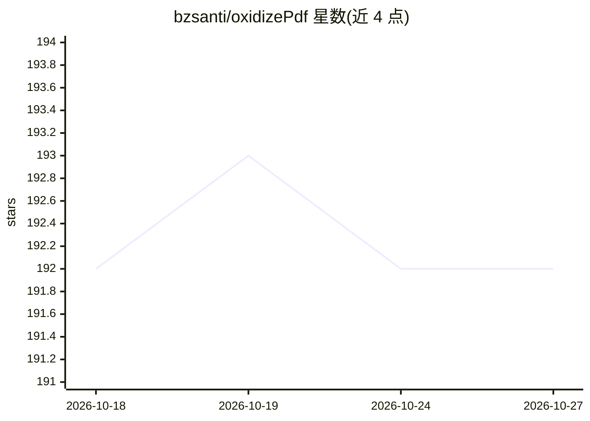

# bzsanti/oxidizePdf

⭐ 192 · Rust · MIT · 推送 2026-10-26 · [GitHub](https://github.com/bzsanti/oxidizePdf) · [官网](https://bzsanti.github.io/oxidizePdf/) · 个人维护

**纯 Rust PDF 库：解析/生成/加密/签名，并输出面向 RAG 的结构化分块**

单一 Rust crate 覆盖 PDF 生成、解析、合并拆分、加密（RC4/AES-128/AES-256 R5 读写、R6 读）、数字签名检测与 PKCS#7 验证、PDF/A 8 级合规校验、JBIG2 解码、发票抽取与 CJK 支持，无 C 依赖。面向 AI/RAG 场景提供结构感知分块 rag_chunks：每块含页码、边界框、元素类型、标题上下文与 token 估计，支持确定性 no-ML 上下文前缀与 Markdown/JSON 导出。不做页面栅格化，PAdES 与证书收件人加密不在范围内。

## 筛选速览

| 维度 | 判定 | 备注 |
|---|---|---|
| AI 角色 | `ai-ecosystem` | LLM/agent 周边工具 |
| 许可风险 | `permissive` | MIT |
| 部署形态 | `library` | 以包/库形式分发 |
| 模型依赖 | — | README 未给出锁定关系 |
| 硬件要求 | — | 无带数字的原话,不猜 |
| 安装摩擦 | `low` | 无编译、无系统依赖或容器化 |
| 成熟度 | — | 结构信号不足 |

## 能力要点

- 结构感知分块含页码/边界框/元素类型/标题上下文/token 估计
- 确定性 no-ML Contextual Retrieval 前缀，可复现 chunk_id
- PDF/A 8 级合规校验与 PKCS#7 签名验证，纯 Rust 无 C 依赖
- 99.3% 解析成功率（9,000+ 真实 PDF 语料）与 7,993 个测试

## 适用场景

- 构建 RAG 摄取管线，把 PDF 转为带元数据分块送入向量库
- 批量解析/生成 PDF，含加密与数字签名校验
- 按元素类型（表格/标题/段落）精细控制抽取粒度

## 场景标签

`文档解析` `RAG` · 领域:知识与检索

## 证据(README 行号)

> L28: Structure-aware RAG remains a first-class workflow:
> L31: let chunks = PdfDocument::open("paper.pdf")?.rag_chunks()?;
> L159: - Structure-aware chunking with `RagChunk` metadata (pages, bboxes, types, headings)

## 星数曲线

2026-10-18 192 → 2026-10-27 192（+0）

---
*卡片 v1 · prompt 1.4 · 生成 2026-10-22 · 置信度 high · 依据 README sha `9ddd54db7da7` · [字段定义](../../DATASET.md)*
