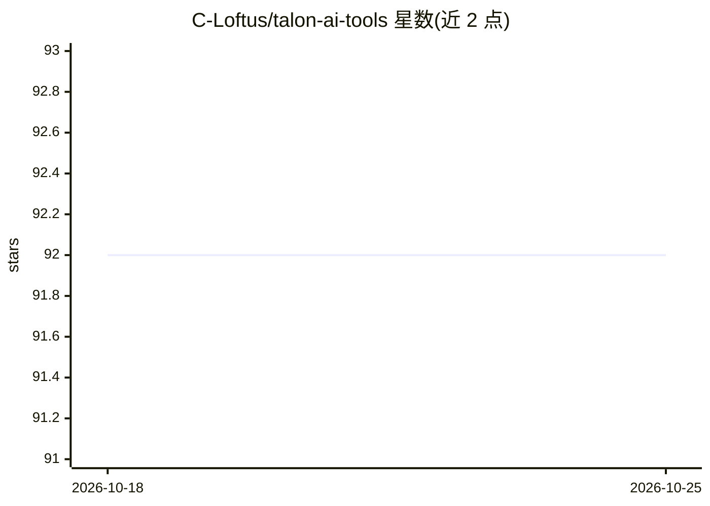

# C-Loftus/talon-ai-tools

⭐ 92 · Python · MIT · 推送 2026-10-19 · [GitHub](https://github.com/C-Loftus/talon-ai-tools) · [官网](http://colton.place/talon-ai-tools/) · 个人维护

**用 Talon 语音命令操作 LLM 与 AI 工具的口部输入工具集**

基于 Talon Voice 语音输入引擎的 Talon 用户目录插件，通过语音命令控制大语言模型与 AI 工具，面向语音编程（Cursorless）、减少键盘使用（手部健康问题）与文本编辑纠错的用户。支持 GitHub Copilot、OpenAI API 文本生成与图像识别，提供三种 LLM 接入方式：直接 OpenAI key、simonw/llm CLI（推荐，本地日志可查）与任意 OpenAI 兼容自定义端点（Azure、llamafiles、ollama 等）。以 git clone 到 Talon 用户目录方式安装。

## 筛选速览

| 维度 | 判定 | 备注 |
|---|---|---|
| AI 角色 | `ai-native` | 本体是模型或模型工具 |
| 许可风险 | `permissive` | MIT |
| 部署形态 | `None` |  |
| 模型依赖 | — | README 未给出锁定关系 |
| 硬件要求 | — | 无带数字的原话,不猜 |
| 安装摩擦 | `low` | 无编译、无系统依赖或容器化 |
| 成熟度 | — | 结构信号不足 |

## 能力要点

- 语音命令调用 LLM 进行文本生成、处理与图像识别
- 三种模型接入方式：OpenAI key / simonw/llm CLI / OpenAI 兼容自定义端点
- 支持 GitHub Copilot 与 OpenAI API
- GPT、Copilot 目录提供用法示例

## 适用场景

- 语音编程时用命令调用 GPT/Copilot 辅助编码
- 因手部健康问题减少键盘操作，语音使用 AI 工具
- 口述后快速用 LLM 修正文本与听写错误

## 场景标签

`AI 助手` · 领域:对话与助手

## 证据(README 行号)

> L3: **Control large language models and AI tools through voice commands using the Talon Voice dictation engine.**
> L14: - Github Copilot

## 星数曲线

2026-10-18 92 → 2026-10-25 92（+0）

---
*卡片 v1 · prompt 1.4 · 生成 2026-10-23 · 置信度 high · 依据 README sha `4509010a6833` · [字段定义](../../DATASET.md)*
