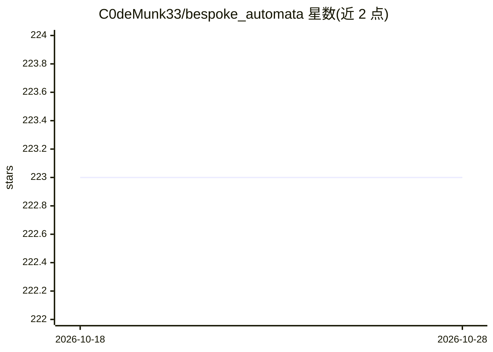

# C0deMunk33/bespoke_automata

⭐ 223 · JavaScript · GPL-3.0 · 推送 2026-02-23 · [GitHub](https://github.com/C0deMunk33/bespoke_automata) · 个人维护

**本地离线设计与部署 AI Agent 的图形化工具（MCP 暴露）**

基于 Node.js 与 Express 的桌面/本地 Web 应用：通过 LiteGraph 有向图 GUI 设计与测试“Brain”（组合 LLM、数据库 IO、逻辑、API 等节点），保存后部署为单一 API 端点，并将每个 Brain 注册为 MCP 工具供 Cursor、Claude Desktop 等 MCP 客户端调用。可选 BA API 后端基于 llama-cpp-python 在本地跑文本与视觉推理（GGUF 格式）。无需 Docker，git clone 后 npm install/start 运行，需 Node.js v18+。

## 筛选速览

| 维度 | 判定 | 备注 |
|---|---|---|
| AI 角色 | `ai-ecosystem` | LLM/agent 周边工具 |
| 许可风险 | `viral` | GPL-3.0 |
| 部署形态 | `library` | 以包/库形式分发 |
| 模型依赖 | local-ok | 支持本地模型 |
| 硬件要求 | — | 无带数字的原话,不猜 |
| 安装摩擦 | `medium` | 含编译或系统依赖之一 |
| 成熟度 | — | 结构信号不足 |

## 能力要点

- LiteGraph 有向图 GUI 设计 Agent（Brain）
- 每个 Brain 注册为 MCP 工具，暴露 SSE 端点
- 可选 llama-cpp-python 本地推理后端（文本/视觉，GGUF）
- 提供独立 MCP 服务器模式与 REST API

## 适用场景

- 在本地可视化搭建并调试多节点 AI Agent
- 把自建 Agent 作为 MCP 工具接入 Cursor / Claude Desktop
- 离线运行本地 LLM 驱动的 Agent 推理

## 场景标签

`Agent 框架` · 领域:Agent 开发

## 证据(README 行号)

> L8: Create and deploy sophisticated Agent AI's to a single API with Bespoke Automata. With Bespoke Automata, you can com
> L10: With Bespoke Automata, you can design and test brains via a Directed Graph GUI (powered by litegraph), and deploy t

## 星数曲线

2026-10-18 223 → 2026-10-28 223（+0）

---
*卡片 v1 · prompt 1.4 · 生成 2026-10-22 · 置信度 mid · 依据 README sha `20c78b1df2c5` · [字段定义](../../DATASET.md)*
