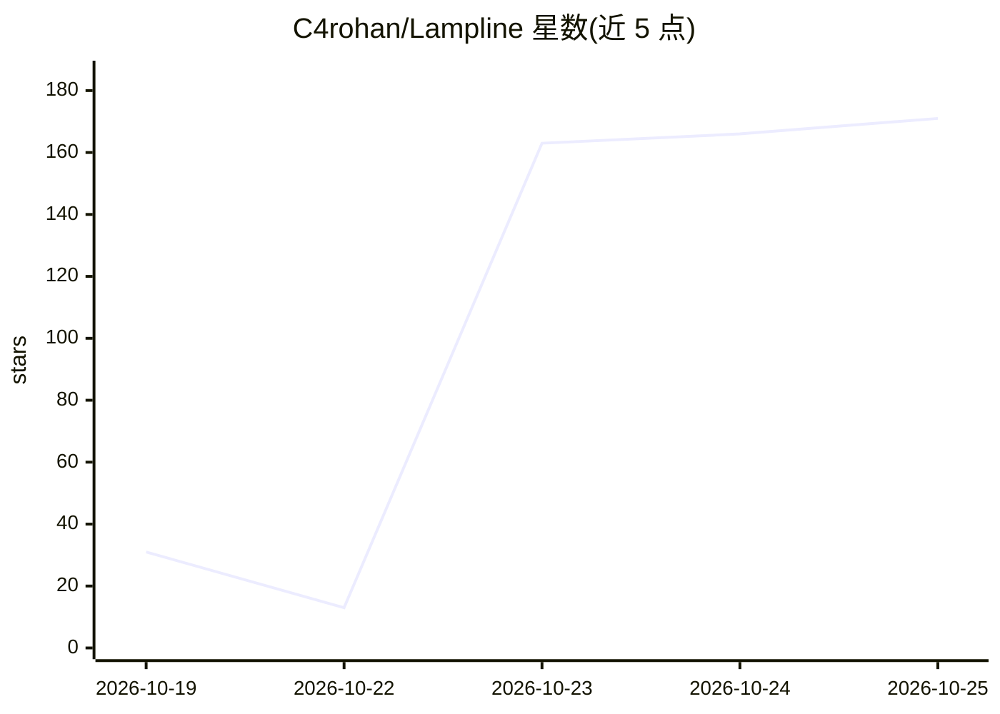

# C4rohan/Lampline

⭐ 283 · Python · Apache-2.0 · 推送 2026-10-24 · [GitHub](https://github.com/C4rohan/Lampline) · 个人维护

**自托管开源语音电话 agent 平台：导入 Dialogflow CX 构建测试运行**

在本地或自有服务器上构建、测试与运行语音电话 agent 的自托管平台（Apache-2.0）。可导入 Dialogflow CX 与 CX Agent Studio 的导出包（flows、pages、playbooks、forms、tools 双向转换），提供拖拽式构建器、步骤点亮式测试控制台、HTTP/MCP 工具、内置数据集合与文档搜索，电话经 Twilio、Telnyx 或经 jambonz 的任意 SIP 中继接入。Evals 功能用 AI Test Caller 真实拨号并按检查项评分。支持 20 家模型提供商或 Ollama 本地运行，一条 Docker 命令启动无需 API key。基于 Pipecat 构建，agent 以 YAML+Markdown 文件夹形式版本管理，附 vk CLI。限制：Google Cloud 部署与 Genesys/Avaya 等联络中心集成标注 coming soon。

## 筛选速览

| 维度 | 判定 | 备注 |
|---|---|---|
| AI 角色 | `ai-ecosystem` | LLM/agent 周边工具 |
| 许可风险 | `permissive` | Apache-2.0 |
| 部署形态 | `self-host` | docker 或自建部署 |
| 模型依赖 | local-ok | 支持本地模型 |
| 硬件要求 | — | 无带数字的原话,不猜 |
| 安装摩擦 | `low` | 无编译、无系统依赖或容器化 |
| 成熟度 | `idea` | |

## 能力要点

- Dialogflow CX / CX Agent Studio agent 双向导入导出
- AI Test Caller 真实电话拨测并按检查项评分，经 Google Voice 免费通话
- 20 家模型提供商可选，--free 模式用 Ollama+Moonshine+Kokoro 全本地运行无需 API key
- agent 以 YAML+Markdown 文件夹管理，vk CLI 支持 lint/test/import/export

## 适用场景

- 把 Dialogflow CX 上已建的联络中心 agent 迁到自有硬件运行
- 上线前用真实电话线对语音 agent 做评分测试
- 在本地无 API key 环境搭建和调试语音电话 agent
- 以 git 版本管理方式维护 agent 并接入 Twilio/Telnyx/SIP 电话线路

## 场景标签

`语音 Agent` · 领域:对话与助手

## 证据(README 行号)

> L29: Lampline imports your Dialogflow CX and CX Agent Studio agents, flows, pages,
> L33: Telnyx or any SIP trunk through jambonz. Built on
> L44: Lampline's **Evals** tab phones a voice agent over a real phone line, plays the

## 星数曲线

2026-10-19 31 → 2026-10-25 171（+140）

---
*卡片 v1 · prompt 1.4 · 生成 2026-10-23 · 置信度 mid · 依据 README sha `60d690669761` · [字段定义](../../DATASET.md)*
