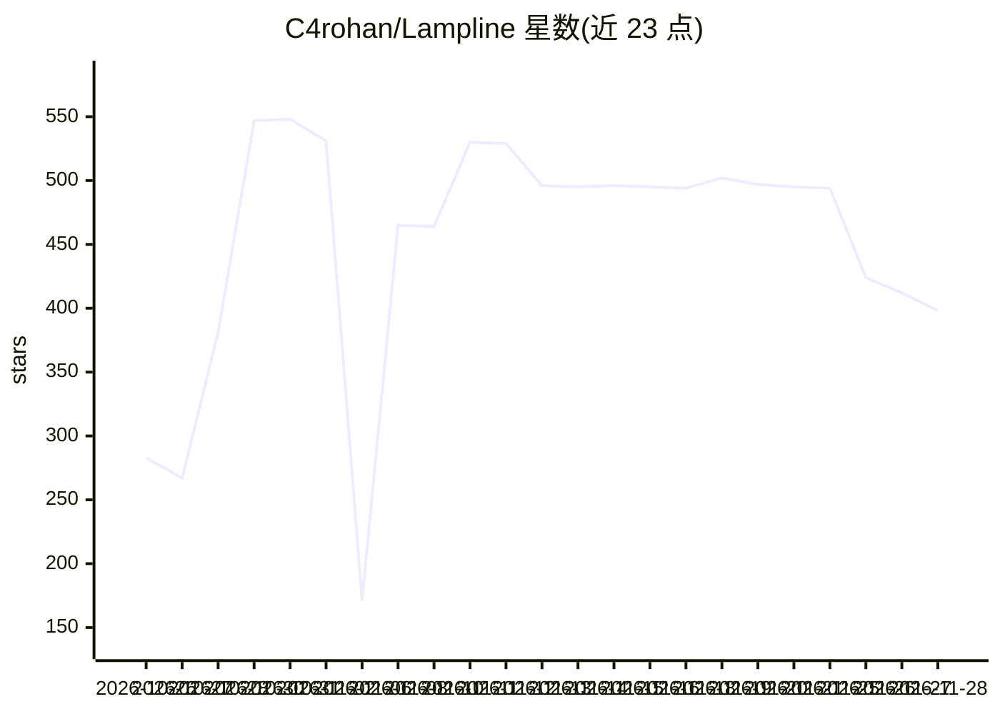

# C4rohan/Lampline

⭐ 398 · Python · Apache-2.0 · 推送 2026-11-25 · [GitHub](https://github.com/C4rohan/Lampline) · 个人维护

**在本地自托管构建并电话实测 AI 语音坐席的开源平台**

以 YAML/Markdown 文件形式定义电话语音坐席（agents as code），提供 vk CLI 做离线检查与对话测试，由 AI Test Caller 拨打真实电话并逐条评分转录。支持导入/导出 Dialogflow CX 与 CX Agent Studio 坐席，拖拽式构建器混合脚本页与 LLM 步骤，通过 Twilio、Telnyx 或 SIP trunk（经 jambonz）接电话。内置 Claude Code/Cursor/Codex 技能用于构建、修复、评审坐席；默认 --free 模式用本地 Qwen3 4B（Ollama）与 Moonshine/Kokoro 语音，无需 API key。

## 筛选速览

| 维度 | 判定 | 备注 |
|---|---|---|
| AI 角色 | `ai-ecosystem` | LLM/agent 周边工具 |
| 许可风险 | `permissive` | Apache-2.0 |
| 部署形态 | `self-host` | docker 或自建部署 |
| 模型依赖 | local-ok | 支持本地模型 |
| 硬件要求 | — | 无带数字的原话,不猜 |
| 安装摩擦 | `low` | 无编译、无系统依赖或容器化 |
| 成熟度 | — | 结构信号不足 |

## 能力要点

- YAML 定义坐席并用 vk lint/test 运行对话测试，真实电话由 AI Test Caller 拨打并评分
- 导入/导出 Dialogflow CX 与 CX Agent Studio（flows/pages/playbooks 双向映射）
- --free 模式本地运行 Qwen3 4B + Moonshine + Kokoro，无 API key、无遥测
- 提供 Claude Code 插件与 4 个 agent 技能，及 vk mcp 工具服务

## 适用场景

- 上線前对 Dialogflow CX 电话坐席写回归测试并自动评分
- 在自己的服务器或笔记本上跑自托管语音坐席平台
- 用编码 agent 自动构建、修复并评审电话坐席
- 通过 Google Voice 浏览器桥免费测试任意带号码的语音坐席

## 场景标签

`语音 Agent` · 领域:对话与助手

## 证据(README 行号)

> L3:  Test and run phone agents on your own machine.
> L6:  run them from Claude Code or CI, and have real phone calls graded by an AI caller.
> L63: SIP trunk through jambonz. Import from Dialogflow CX and CX Agent Studio, or
> L64: export back, whenever you like. Built on Pipecat.

## 星数曲线

2026-10-26 283 → 2026-11-28 398（+115）

---
*卡片 v1 · prompt 1.4 · 生成 2026-11-26 · 置信度 high · 依据 README sha `2609ea5a1e7e` · [字段定义](../../DATASET.md)*
