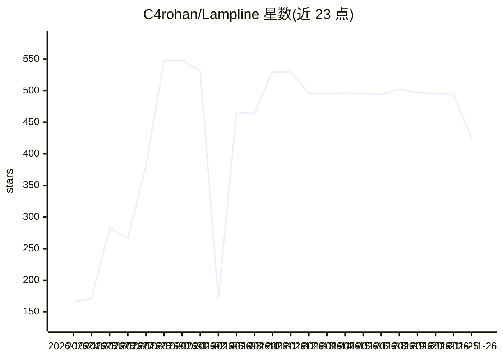

# C4rohan/Lampline

⭐ 424 · Python · Apache-2.0 · 推送 2026-11-25 · [GitHub](https://github.com/C4rohan/Lampline) · 个人维护

**在本地构建并测试电话语音 AI agent 的开源平台**

Lampline 是一个本地运行的电话语音 agent 构建与测试平台：agent 以 YAML/Markdown 文件描述（agents-as code），用 vk CLI 做 lint、测试、导入导出；测试可由 AI Test Caller 拨打真实电话并按检查项逐条评分。支持导入/导出 Dialogflow CX 与 CX Agent Studio，内置拖拽式 builder、HTTP/MCP 工具、记录与文档检索，电话接入走 Twilio、Telnyx 或 SIP（经 jambonz），基于 Pipecat。提供 Claude Code 插件与 skills，测试路径无需 API key，整套平台经 Docker 一条命令启动，模型与语音可走本地 Ollama、Moonshine、Kokoro。

## 筛选速览

| 维度 | 判定 | 备注 |
|---|---|---|
| AI 角色 | `ai-ecosystem` | LLM/agent 周边工具 |
| 许可风险 | `permissive` | Apache-2.0 |
| 部署形态 | `self-host` | docker 或自建部署 |
| 模型依赖 | local-ok | 支持本地模型 |
| 硬件要求 | — | 无带数字的原话,不猜 |
| 安装摩擦 | `low` | 无编译、无系统依赖或容器化 |
| 成熟度 | — | 结构信号不足 |

## 能力要点

- agent 以 YAML/Markdown 文件表达，vk CLI 完成 lint/test/import/export
- AI Test Caller 拨打真实电话并逐项评分，含响应时间 p95 统计
- Dialogflow CX / CX Agent Studio 双向导入导出映射
- 20 个模型提供商可选，或本地 Ollama + Moonshine + Kokoro 免 key 运行

## 适用场景

- 为电话客服 agent 编写回归测试并在 CI 中运行
- 把 Dialogflow CX agent 迁到本地自托管环境
- 用 AI 模拟吵闹/打断/口音等复杂来电者考验语音 agent
- 从编码代理（Claude Code 等）构建和修复语音 agent

## 场景标签

`语音 Agent` · 领域:对话与助手

## 证据(README 行号)

> L5:  Write conversation tests for your phone agents, including Dialogflow CX and CX Agent Studio agents,
> L6:  run them from Claude Code or CI, and have real phone calls graded by an AI caller.
> L60: **Run it.** The same agents take real calls on hardware you control: a
> L64: export back, whenever you like. Built on Pipecat.

## 星数曲线

2026-10-24 166 → 2026-11-26 424（+258）

---
*卡片 v1 · prompt 1.4 · 生成 2026-11-25 · 置信度 high · 依据 README sha `077972c9401a` · [字段定义](../../DATASET.md)*
