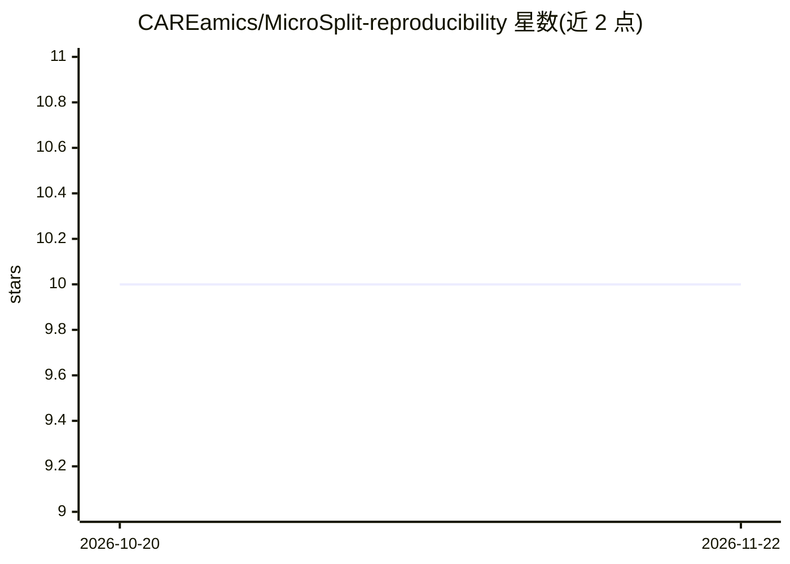

# CAREamics/MicroSplit-reproducibility

⭐ 10 · Python · BSD-3-Clause · 推送 2026-05-12 · [GitHub](https://github.com/CAREamics/MicroSplit-reproducibility) · 组织维护

**复现 MicroSplit 论文结果的笔记本与工具仓库**

CAREamics 团队为复现 MicroSplit 论文（Nature Methods，荧光显微数据语义解混）结果而维护的仓库：提供按流水线编号的 Jupyter 笔记本（噪声模型构建、训练、推理、误差校准）与配套工具，基于层次化变分自编码器（LVAE）。MicroSplit 实现位于 CAREamics 库中，本仓库使用当时的 CAREamics 版本，正在重构整合。训练需 GPU，示例可加载预训练模型仅做推理。安装通过 mamba/conda 环境加 pip 完成。

## 筛选速览

| 维度 | 判定 | 备注 |
|---|---|---|
| AI 角色 | `ai-knowledge` | 知识聚合/清单类 |
| 许可风险 | `permissive` | BSD-3-Clause |
| 部署形态 | `library` | 以包/库形式分发 |
| 模型依赖 | — | README 未给出锁定关系 |
| 硬件要求 | — | 无带数字的原话,不猜 |
| 安装摩擦 | `medium` | 含编译或系统依赖之一 |
| 成熟度 | — | 结构信号不足 |

## 能力要点

- 覆盖流水线四步的编号笔记本：噪声模型、训练、推理、误差校准
- 除校准外各步骤均提供预训练模型入口，无需从头训练
- 列出 Linux/macOS/Windows 三套已测试系统及对应 GPU 配置
- 附论文引用信息与 14 个数据集链接

## 适用场景

- 复现 MicroSplit 论文中的显微图像计算复用实验
- 在预训练模型上快速测试显微图像语义解混
- 为自己的荧光通道数据构建噪声模型并训练

## 场景标签

`模型训练` `图像视频处理` · 领域:感知与多模态

## 证据(README 行号)

> L23: MicroSplit is implemented in the CAREamics library, and
> L24: this repository contains example notebooks and utilities for reproducing the results
> L153: Ashesh, Ashesh, et al. "Micro Split: semantic unmixing of fluorescent microscopy data." Nature Methods (2026): 1-1

## 星数曲线

2026-10-20 10 → 2026-11-22 10（+0）

---
*卡片 v1 · prompt 1.4 · 生成 2026-11-20 · 置信度 high · 依据 README sha `775328bbf3f7` · [字段定义](../../DATASET.md)*
