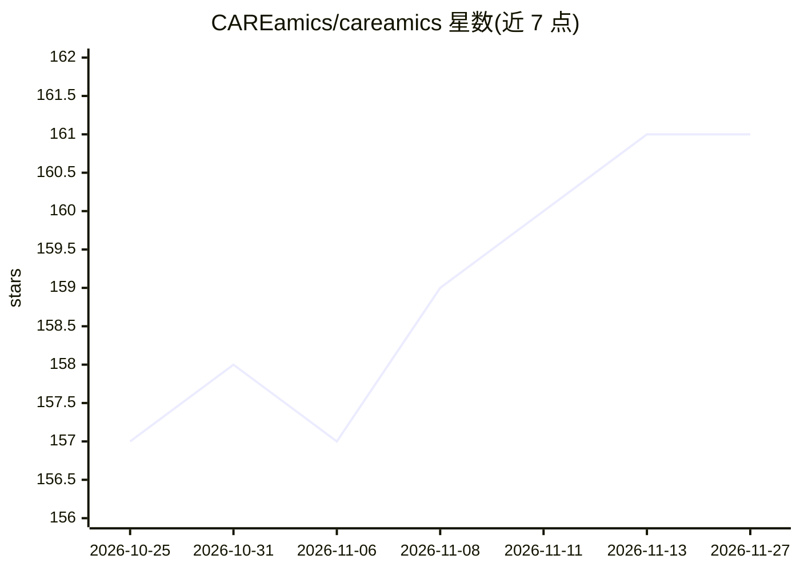

# CAREamics/careamics

⭐ 161 · Python · BSD-3-Clause · 推送 2026-11-26 · [GitHub](https://github.com/CAREamics/careamics) · [官网](https://careamics.github.io/) · 组织维护

**面向科研用户的图像去噪/复原 PyTorch 库**

CAREamics 是一个基于 PyTorch 的显微图像复原库，将 Noise2Void 及其多个变体（CARE、Noise2Noise、N2V2、P(P)N2V、HDN、MicroSplit 等）统一到一个包中，提供简单一致的 API，后端依赖 PyTorch Lightning。动机是 `n2v` 包基于 TensorFlow，而更新的 PyTorch 去噪方法缺少社区可用的完整功能。项目还提供文档与教程，说明如何在科学场景中使用这些方法；安装指引见官方文档。

## 筛选速览

| 维度 | 判定 | 备注 |
|---|---|---|
| AI 角色 | `ai-native` | 本体是模型或模型工具 |
| 许可风险 | `permissive` | BSD-3-Clause |
| 部署形态 | `library` | 以包/库形式分发 |
| 模型依赖 | — | README 未给出锁定关系 |
| 硬件要求 | — | 无带数字的原话,不猜 |
| 安装摩擦 | `low` | 无编译、无系统依赖或容器化 |
| 成熟度 | — | 结构信号不足 |

## 能力要点

- 统一实现 Noise2Void 及多种变体（CARE、N2V2、PPN2V、HDN、MicroSplit 等）
- 基于 PyTorch Lightning 后端，提供一致的 API
- 提供面向科学应用场景的文档与教程

## 适用场景

- 对显微成像数据做去噪处理
- 在科研流程中使用 Noise2Void 系列自监督去噪方法
- 在 PyTorch 环境中替代 TensorFlow 版 n2v 包

## 场景标签

`科研工具` `图像视频处理` · 领域:学习与行业

## 证据(README 行号)

> L14: CAREamics is a PyTorch library aimed at simplifying the use of Noise2Void and its many
> L24: The aim of CAREamics is to provide a PyTorch library reuniting all the latest methods
> L26: PyTorch Lightning as a back-end. In addition, we will provide extensive documentation and

## 星数曲线

2026-10-25 157 → 2026-11-27 161（+4）

---
*卡片 v1 · prompt 1.4 · 生成 2026-11-27 · 置信度 mid · 依据 README sha `58ab5479c826` · [字段定义](../../DATASET.md)*
