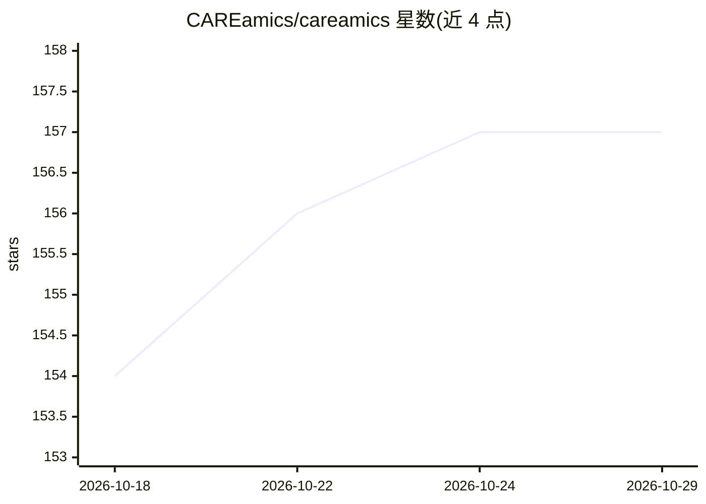

# CAREamics/careamics

⭐ 157 · Python · BSD-3-Clause · 推送 2026-10-28 · [GitHub](https://github.com/CAREamics/careamics) · [官网](https://careamics.github.io/) · 组织维护

**面向显微图像去噪的 PyTorch 深度学习库：统一 Noise2Void 及变体**

CAREamics 是一个 PyTorch 库，将 Noise2Void 及其变体和相关方法（CARE、Noise2Noise、N2V2、P(P)N2V、HDN、muSplit 等）整合到单一包中，提供统一且简化的 API；后端依赖 PyTorch Lightning。README 说明其动机：n2v 包基于 TensorFlow，而较新的方法虽为 PyTorch 实现但缺少社区可用的附加功能。面向科研场景用户，承诺提供文档与教程；安装说明指向外部文档站点，未在 README 中给出具体命令。

## 筛选速览

| 维度 | 判定 | 备注 |
|---|---|---|
| AI 角色 | `ai-native` | 本体是模型或模型工具 |
| 许可风险 | `permissive` | BSD-3-Clause |
| 部署形态 | `library` | 以包/库形式分发 |
| 模型依赖 | — | README 未给出锁定关系 |
| 硬件要求 | — | 无带数字的原话,不猜 |
| 安装摩擦 | `low` | 无编译、无系统依赖或容器化 |
| 成熟度 | — | 结构信号不足 |

## 能力要点

- 整合 Noise2Void 及多种变体（CARE/N2N/N2V2/PPN2V/HDN/muSplit 等）
- 基于 PyTorch Lightning 后端，提供统一 API
- 以科学（科研显微成像）应用为目标场景

## 适用场景

- 用 Noise2Void 系方法对显微图像做去噪
- 在一个 PyTorch 包内切换多种去噪算法而无需分别安装多个实现
- 科研工作中按文档与教程应用自监督去噪方法

## 场景标签

`科研工具` `图像视频处理` · 领域:学习与行业

## 证据(README 行号)

> L14: CAREamics is a PyTorch library aimed at simplifying the use of Noise2Void and its many
> L24: The aim of CAREamics is to provide a PyTorch library reuniting all the latest methods
> L27: tutorials on how to best apply these methods in a scientific context.

## 星数曲线

2026-10-18 154 → 2026-10-29 157（+3）

---
*卡片 v1 · prompt 1.4 · 生成 2026-10-22 · 置信度 mid · 依据 README sha `8d150e234782` · [字段定义](../../DATASET.md)*
