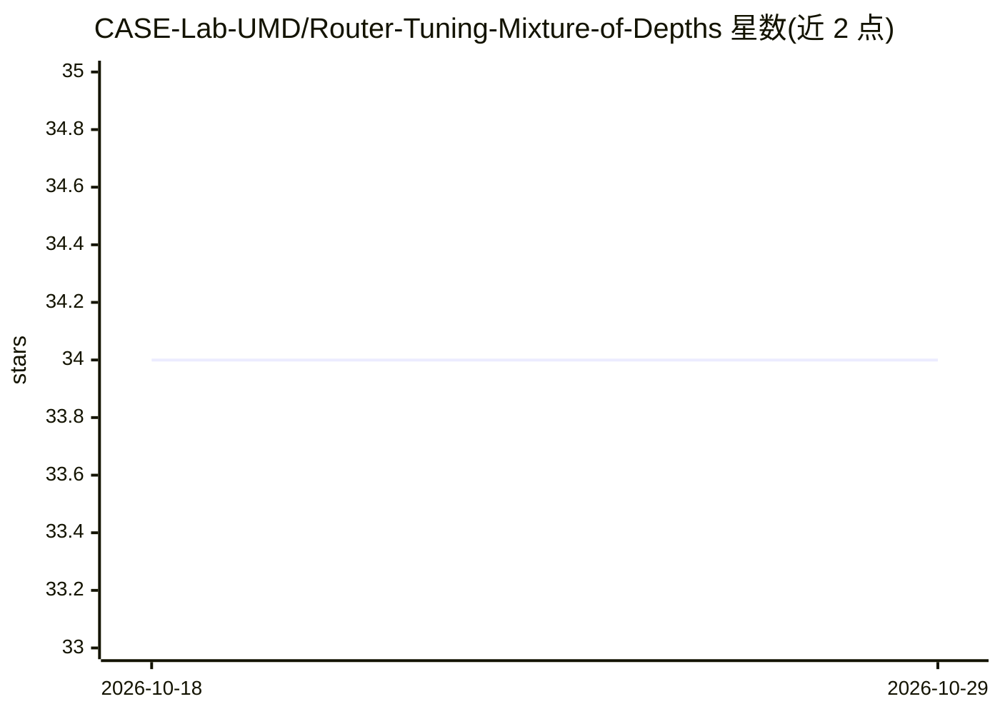

# CASE-Lab-UMD/Router-Tuning-Mixture-of-Depths

⭐ 34 · Python · 推送 2026-10-02 · [GitHub](https://github.com/CASE-Lab-UMD/Router-Tuning-Mixture-of-Depths) · [官网](https://aclanthology.org/2025.emnlp-main.99) · 组织维护

**EMNLP 2025 论文官方实现：冻结主干、只训路由器的动态深度方法**

Router-Tuning（EMNLP 2025）的官方开源实现，来自马里兰大学 CASE Lab 与腾讯 AI Lab。方法保持 Transformer 主干权重 100% 冻结，仅训练每层轻量路由模块（单线性投影 + Straight-Through Estimator 离散化），让 token 按难度跳过 self-attention/MLP/整层，从而降低 FLOPs 并获得推理加速；支持 token/序列两级粒度、目标容量正则与 LoRA 组合。代码基于 PyTorch/DeepSpeed/Accelerate 提供，用 lm-evaluation-harness 评测。

## 筛选速览

| 维度 | 判定 | 备注 |
|---|---|---|
| AI 角色 | `ai-ecosystem` | LLM/agent 周边工具 |
| 许可风险 | `none` | — |
| 部署形态 | `None` |  |
| 模型依赖 | — | README 未给出锁定关系 |
| 硬件要求 | — | 无带数字的原话,不猜 |
| 安装摩擦 | `medium` | 含编译或系统依赖之一 |
| 成熟度 | — | 结构信号不足 |

## 能力要点

- 主干权重 100% 冻结，仅训练轻量逐层路由器（<0.1M 参数）
- 支持 attn/mlp/block × token/sequence 六种路由粒度
- 容量正则损失可显式控制 token 跳过率
- 可与 LoRA 适配器组合，配合 DeepSpeed/Accelerate 分布式训练

## 适用场景

- 在已微调模型上叠加动态深度以降低推理 FLOPs
- 研究 token 级层跳过与路由特化行为
- 复现论文在 LLaMA-2/Mistral/Qwen-2.5 上的评测结果

## 场景标签

`微调` · 领域:训练与推理

## 证据(README 行号)

> L34: **Router-Tuning (RT)** presents a simple, parameter-efficient, and effective paradigm for enabling dynamic depth:
> L36: 2. **Lightweight Router Training**: Only tunes compact per-layer routing modules (single linear projection + Straig
> L146: Launch distributed router-only training with `accelerate` and DeepSpeed:

## 星数曲线

2026-10-18 34 → 2026-10-29 34（+0）

---
*卡片 v1 · prompt 1.4 · 生成 2026-10-25 · 置信度 high · 依据 README sha `888f4383501c` · [字段定义](../../DATASET.md)*
