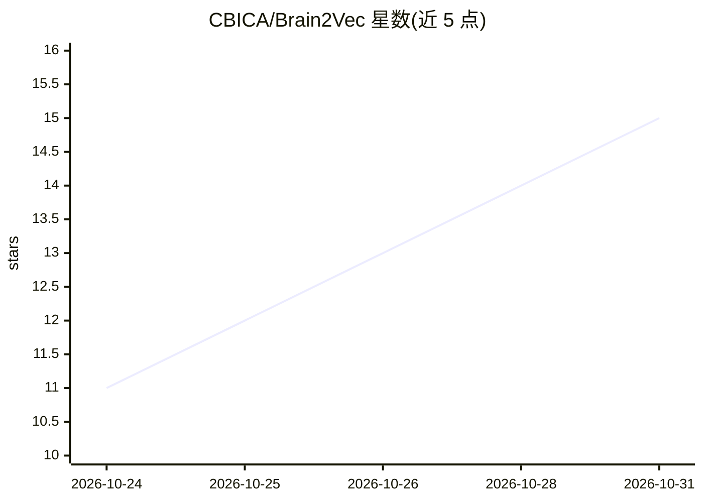

# CBICA/Brain2Vec

⭐ 15 · Python · NOASSERTION · 推送 2026-10-27 · [GitHub](https://github.com/CBICA/Brain2Vec) · 组织维护

**结构脑 MRI 的自监督 3D 基础模型：嵌入提取与疾病/脑龄预测**

基于 PyTorch 的脑 MRI 基础模型代码库：模型在 74,425 例 T1 加权脑 MRI 上自监督预训练（遵循 Meta 的 Masked Autoencoders 实现），支持 ViT 编码器微调、768 维嵌入特征提取、用嵌入训练下游 ML 模型（SVM 等做疾病分类与脑龄回归），并提供预训练疾病分类模型的推理。本地使用需先在 HuggingFace 申请模型访问，输入须经去颅骨与线性配准预处理；也可通过 NiChart 云端上传原始扫描免预处理、免 GPU 使用。训练在 SLURM 集群上验证，其他环境未测试。

## 筛选速览

| 维度 | 判定 | 备注 |
|---|---|---|
| AI 角色 | `ai-native` | 本体是模型或模型工具 |
| 许可风险 | `none` | NOASSERTION |
| 部署形态 | `library` | 以包/库形式分发 |
| 模型依赖 | — | README 未给出锁定关系 |
| 硬件要求 | — | 无带数字的原话,不猜 |
| 安装摩擦 | `low` | 无编译、无系统依赖或容器化 |
| 成熟度 | — | 结构信号不足 |

## 能力要点

- 74,425 例 T1w MRI 自监督预训练的 3D 基础模型
- 冻结编码器输出 768 维嵌入供 SVM/MLP 等下游模型使用
- 支持 ViT 编码器微调与疾病分类/脑龄回归
- 提供去颅骨（NiChart_DLMUSE）+ 线性配准（flirt）预处理流水线

## 适用场景

- 提取脑 MRI 嵌入用于疾病分类或脑龄回归研究
- 用预训练编码器初始化 ViT 做下游任务微调
- 在 NiChart 云端免安装使用 Brain2Vec 打分

## 场景标签

`微调` · 领域:训练与推理

## 证据(README 行号)

> L6: Code for the Brain2Vec paper, a 3D foundation model pre-trained on 74,425
> L10: or perform downstream classification inference using our pre-trained disease
> L35: We proved that using Brain2Vec embeddings we get superior or on-par classification

## 星数曲线

2026-10-24 11 → 2026-10-31 15（+4）

---
*卡片 v1 · prompt 1.4 · 生成 2026-10-31 · 置信度 high · 依据 README sha `e315d5ab9231` · [字段定义](../../DATASET.md)*
