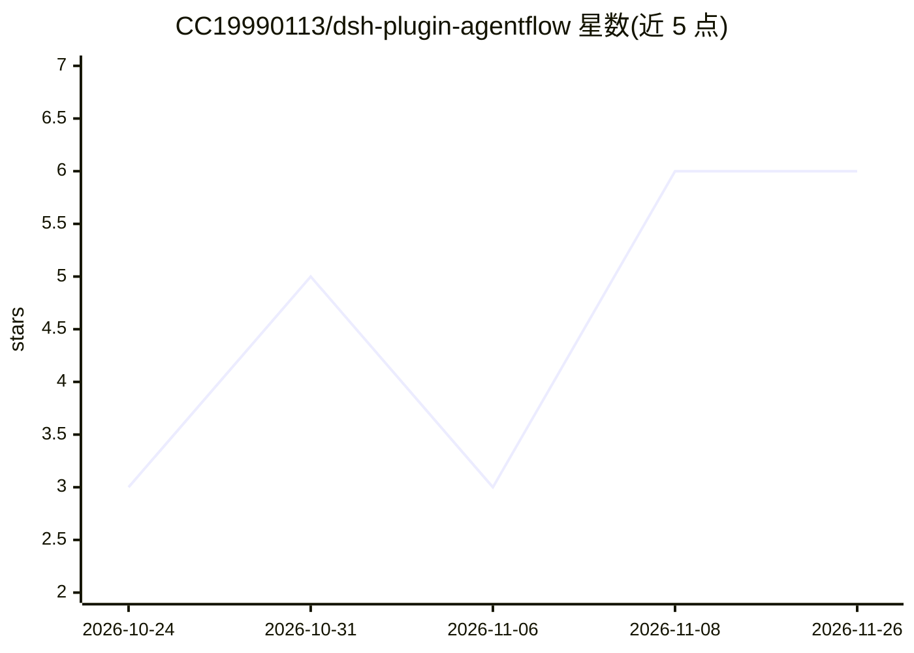

# CC19990113/dsh-plugin-agentflow

⭐ 6 · JavaScript · MIT · 推送 2026-10-29 · [GitHub](https://github.com/CC19990113/dsh-plugin-agentflow) · [官网](https://www.npmjs.com/package/dsh-plugin-agentflow) · 个人维护 · 中文 README

**DSH 插件：画布编排 agent 工作流生成对话命令**

DeepSeek Harness（DSH）的插件，以可视化画布方式编排 agent 工作流：节点分 LLM、MCP、调度三类，按纯 DAG 执行（同层并行、失败不阻塞其它分支），每步的模型、推理强度、兜底模型、技能与工具可逐节点配置。编排完成后一键生成 `/命令`，由插件热注册、在对话里运行；运行时为每个节点强制派发 teammate 并校验完成状态，状态落盘支持 DSH 重启后恢复。通过 npm 或 GitHub 安装，要求 DSH 桌面版 0.2.x 与 Node 22+，仅在 macOS 上验证过。

## 筛选速览

| 维度 | 判定 | 备注 |
|---|---|---|
| AI 角色 | `ai-ecosystem` | LLM/agent 周边工具 |
| 许可风险 | `permissive` | MIT |
| 部署形态 | `None` |  |
| 模型依赖 | — | README 未给出锁定关系 |
| 硬件要求 | — | 无带数字的原话,不猜 |
| 安装摩擦 | `low` | 无编译、无系统依赖或容器化 |
| 成熟度 | — | 结构信号不足 |

## 能力要点

- 可视化画布编排 LLM/MCP/调度节点为 DAG 工作流
- 整张画布生成 `/命令`，插件热注册即时生效
- 按 DAG 强制推进：每个节点派发 teammate 并校验完成状态
- 观察器记录每步消息形状与工具调用日志

## 适用场景

- 在 DSH 里把多步 agent 任务编排成可复用的对话命令
- 拆开黑盒 agent 循环，自定义每步用哪个模型和工具
- 调试前先用观察器查看模型实际如何调工具和收工

## 场景标签

`工作流自动化` · 领域:效率与自动化

## 证据(README 行号)

> L15: AgentFlow 把它掰开：**画布上的每张卡片就是一个 agent 步骤**。你决定有几步、谁先谁后、谁并行、每步用哪个模型、能不能调 MCP 工具、做完怎么验收。编排好之后把整张画布生成成一个 DSH 命令，在对话里输入 `
> L19: - **模型**：全部走 DSH 自己的模型通道（`ctx.llm`），推理强度和兜底模型可逐节点配

## 星数曲线

2026-10-24 3 → 2026-11-26 6（+3）

---
*卡片 v1 · prompt 1.4 · 生成 2026-11-20 · 置信度 high · 依据 README sha `4561352354ea` · [字段定义](../../DATASET.md)*
