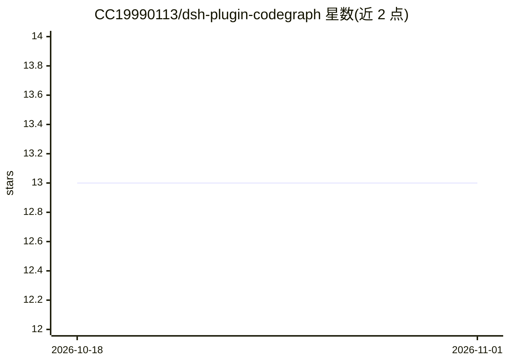

# CC19990113/dsh-plugin-codegraph

⭐ 13 · TypeScript · MIT · 推送 2026-08-24 · [GitHub](https://github.com/CC19990113/dsh-plugin-codegraph) · 个人维护 · 中文 README

**给 DeepSeek Harness agent 提供符号级代码结构查询工具的插件**

DeepSeek Harness (dsh) 的插件，向 agent 暴露 codegraph 与 codegraph_index 两个工具：前者提供 10 种只读操作（符号声明查找、callers/callees、影响面 impact、trace、context 等），后者基于 tree-sitter 构建/刷新磁盘上的符号图索引（schema v4，与 @colbymchenry/codegraph CLI 互通）。内置索引器支持 18 种语言，索引与查询分离，调用解析不猜测、无歧义时不产出边。一条 dsh 命令安装；声明 dsh 本体仍处 developer preview。

## 筛选速览

| 维度 | 判定 | 备注 |
|---|---|---|
| AI 角色 | `ai-ecosystem` | LLM/agent 周边工具 |
| 许可风险 | `permissive` | MIT |
| 部署形态 | `library` | 以包/库形式分发 |
| 模型依赖 | locked-api |  |
| 硬件要求 | — | 无带数字的原话,不猜 |
| 安装摩擦 | `low` | 无编译、无系统依赖或容器化 |
| 成熟度 | `idea` | |

## 能力要点

- 10 种只读符号图查询操作（声明/callers/callees/impact/trace 等）
- tree-sitter 索引器覆盖 TypeScript/Python/Go/Rust 等 18 种语言，语法按需懒加载
- on-disk 格式与 @colbymchenry/codegraph CLI（schema v4）互读互写
- 索引显式触发、文件监视自动刷新、status 报告索引陈旧度

## 适用场景

- 让编码 agent 在改代码前查询谁调用了某符号、改动影响范围
- 在无外部工具的新 workspace 内自建符号索引供 agent 使用
- 与 codegraph CLI 共享同一份索引避免重复构建

## 场景标签

 · 领域:开发者工具/代码智能

## 证据(README 行号)

> L7: Structural code intelligence for DeepSeek Harness (`dsh`).
> L9: Gives the agent two tools — `codegraph` and `codegraph_index` — so it can ask **where is this declared**, **who call
> L117: |`dsh-plugin-codegraph-tool`|Consumer: the model-facing tools, their bounds, and their rendering|

## 星数曲线

2026-10-18 13 → 2026-11-01 13（+0）

---
*卡片 v1 · prompt 1.4 · 生成 2026-10-31 · 置信度 high · 依据 README sha `927ac88fba49` · [字段定义](../../DATASET.md)*
