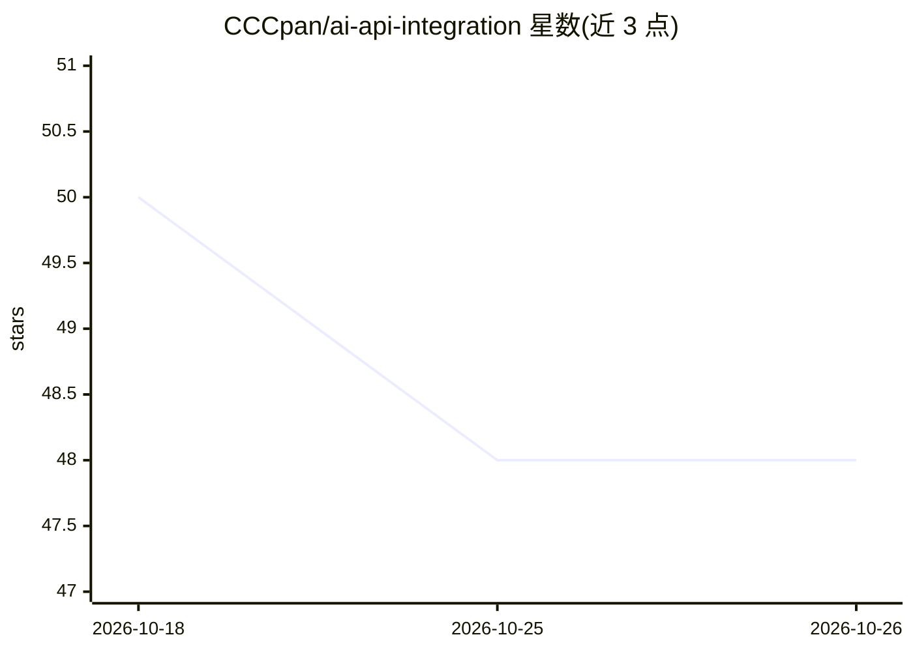

# CCCpan/ai-api-integration

⭐ 48 · Go · MIT · 推送 2026-05-11 · [GitHub](https://github.com/CCCpan/ai-api-integration) · [官网](https://www.xdhdancer.top) · 个人维护 · 中文 README

**大模型 API 统一接入教程库：OpenAI 兼容协议配 10 款工具**

面向国内开发者的 AI API 接入实战教程仓库：以 OpenAI 兼容统一网关方式接入 GPT-5、Claude、Gemini、DeepSeek 等 12+ 模型，提供 10 款 AI 工具（Cursor、Cline、Claude Code、ChatBox、Dify 等）的配置教程、7 类模态的调用说明，以及 Python/Node.js/curl 三种语言的可运行示例。代码为标准 OpenAI 协议，可替换 base_url 指向任意兼容服务（含 OpenAI 官方、LiteLLM、One-API 等）。示例经特定网关（xdhdancer.top/产灵 API）测试。

## 筛选速览

| 维度 | 判定 | 备注 |
|---|---|---|
| AI 角色 | `ai-knowledge` | 知识聚合/清单类 |
| 许可风险 | `permissive` | MIT |
| 部署形态 | `None` |  |
| 模型依赖 | — | README 未给出锁定关系 |
| 硬件要求 | — | 无带数字的原话,不猜 |
| 安装摩擦 | `low` | 无编译、无系统依赖或容器化 |
| 成熟度 | — | 结构信号不足 |

## 能力要点

- 10 款 AI 工具接入教程（IDE/CLI/桌面/Web/低代码/框架）
- 12+ 模型清单与选型建议，model 参数即切换底层模型
- Python / Node.js / curl 三语言代码示例，覆盖流式、function calling、生图等
- 代码为标准 OpenAI 协议，可指向任意兼容 endpoint

## 适用场景

- 我想在 Cursor、ChatBox 等工具里配置统一网关用上多家模型
- 我需要多模态（图片/视频/音频/向量）API 调用的代码参考
- 我初次接入海外大模型，想了解注册、付费与国内访问的处理方案

## 场景标签

`教程课程` · 领域:学习与行业

## 证据(README 行号)

> L57: 本仓库整理了完整的接入流程：
> L59: - **10 款主流 AI 工具** 的配置教程（IDE、CLI、桌面、Web、低代码平台、应用框架）
> L61: - **12+ 主流模型** 的清单、参数说明和选型建议

## 星数曲线

2026-10-18 50 → 2026-10-26 48（-2）

---
*卡片 v1 · prompt 1.4 · 生成 2026-10-25 · 置信度 high · 依据 README sha `08390efbfd4c` · [字段定义](../../DATASET.md)*
