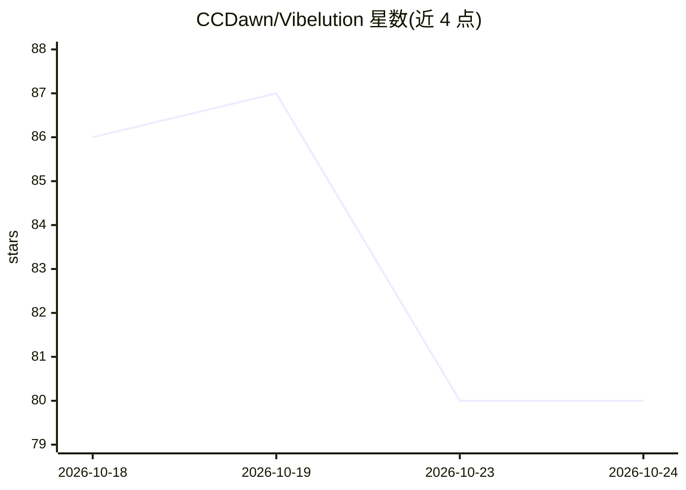

# CCDawn/Vibelution

⭐ 80 · Python · MIT · 推送 2026-10-23 · [GitHub](https://github.com/CCDawn/Vibelution) · [官网](https://github.com/CCDawn/Vibelution#readme) · 个人维护 · 中文 README

**本地优先的多 Agent 协作桌面工作台（Electron）**

面向终端用户的本地 AI Agent 工作台：将规划、开发、评审分派给不同 Agent，在画布与群聊中推进任务；管理私有记忆与正式知识并形成知识图谱；提供金融研究工作台（行情、模拟账户、回测，不含券商交易执行）、虚拟人陪伴插件与个人助理。支持本地或云端模型、MCP 接入、工具授权与受监督的自进化流程（需用户批准）。Windows 提供桌面工作台，macOS/Linux 用浏览器工作台，安装需 Python 3.11+、Node.js 22.12+ 与 Git，便携安装包仍在规划中。

## 筛选速览

| 维度 | 判定 | 备注 |
|---|---|---|
| AI 角色 | `ai-native` | 本体是模型或模型工具 |
| 许可风险 | `permissive` | MIT |
| 部署形态 | `None` |  |
| 模型依赖 | — | README 未给出锁定关系 |
| 硬件要求 | — | 无带数字的原话,不猜 |
| 安装摩擦 | `low` | 无编译、无系统依赖或容器化 |
| 成熟度 | — | 结构信号不足 |

## 能力要点

- 规划/开发/评审分工的多 Agent 团队画布与群聊协作
- 私有记忆与正式知识分治，正式知识带提案、审核与来源管理
- 金融研究工作台：研究、行情、模拟账户、回测与报告
- 本地或云端模型可配，工具/Skills/MCP 接入与本地模型监控

## 适用场景

- 组织多 Agent 团队在画布上规划、开发并评审任务
- 做股票与主题研究并用模拟账户回测复盘
- 通过个人助理跟进待办、目标与平台运行状态

## 场景标签

`多智能体` `AI 助手` `知识图谱` `金融量化` · 领域:Agent 开发

## 证据(README 行号)

> L18: 把规划、开发与评审交给不同的 Agent。在同一张画布上查看成员分工，通过群聊和成员消息推进任务，保留讨论与交接记录。
> L46: 1. 打开桌面的 **Vibelution Launcher**，按模型配置指南设置服务商、模型和密钥引用。
> L52: macOS / Linux 使用浏览器工作台。当前安装需要上述运行环境，便携安装包仍在规划中。工作台在本机运行；使用云端模型时，请求会发给所选服务商，并可能产生费用。

## 星数曲线

2026-10-18 86 → 2026-10-24 80（-6）

---
*卡片 v1 · prompt 1.4 · 生成 2026-10-24 · 置信度 high · 依据 README sha `76ecc5542d37` · [字段定义](../../DATASET.md)*
