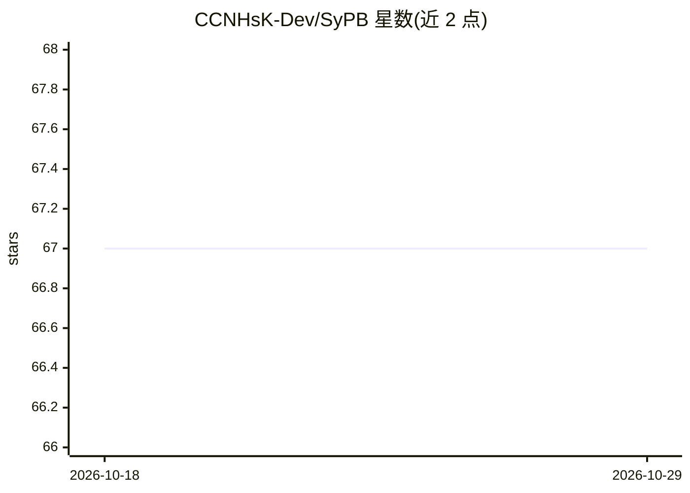

# CCNHsK-Dev/SyPB

⭐ 67 · C++ · GPL-3.0 · 推送 2025-12-17 · [GitHub](https://github.com/CCNHsK-Dev/SyPB) · [官网](http://ccnhsk-dev.blogspot.com/) · 个人维护

**Counter-Strike 1.6 的游戏 Bot 与 NPC 系统（基于 YaPB）**

面向 Counter-Strike 1.6 的机器人项目，基于 YaPB 2.7.2 构建，包含三个组件：SyPB 主 Bot（Beta 1.49）、SwNPC NPC 系统（Beta 1.48，复用 SyPB 路点文件、需 SyPB 环境）以及 SyPB AMXX API（1.48）供 AMX Mod X 插件调用。README 声明仅支持 Windows，未提供源码编译或包管理器安装方式，二进制下载与更多信息通过项目博客站点分发。

## 筛选速览

| 维度 | 判定 | 备注 |
|---|---|---|
| AI 角色 | `ai-native` | 本体是模型或模型工具 |
| 许可风险 | `viral` | GPL-3.0 |
| 部署形态 | `None` |  |
| 模型依赖 | — | README 未给出锁定关系 |
| 硬件要求 | — | 无带数字的原话,不猜 |
| 安装摩擦 | `low` | 无编译、无系统依赖或容器化 |
| 成熟度 | `idea` | |

## 能力要点

- 基于 YaPB 2.7.2 的 CS 1.6 Bot，版本 Beta 1.49
- SwNPC 提供 NPC 系统，复用 SyPB 路点文件
- 提供 AMXX API 供 AMX Mod X 插件集成

## 适用场景

- 在 CS 1.6 服务器中添加 Bot 对战
- 通过 SwNPC 在地图中布置 NPC
- AMXX 插件开发者调用 SyPB API 扩展玩法

## 场景标签

 · 领域:游戏/游戏服务器插件

## 证据(README 行号)

> L2: Counter-Strike 1.6 Bot, Based on YaPB2.7.2
> L5:  - Counter-Strike 1.6 Bot

## 星数曲线

2026-10-18 67 → 2026-10-29 67（+0）

---
*卡片 v1 · prompt 1.4 · 生成 2026-10-24 · 置信度 mid · 依据 README sha `8c24d492e9fc` · [字段定义](../../DATASET.md)*
