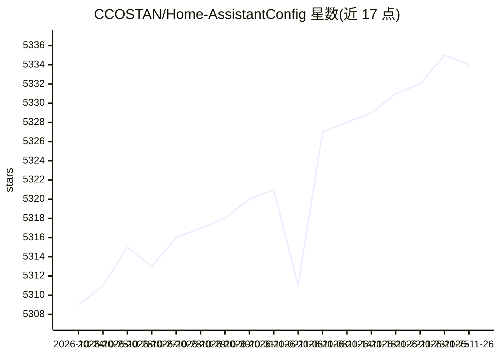

# CCOSTAN/Home-AssistantConfig

⭐ 5,334 · JavaScript · NOASSERTION · 推送 2026-11-24 · [GitHub](https://github.com/CCOSTAN/Home-AssistantConfig) · [官网](https://www.vCloudInfo.com) · 个人维护

**个人智能家居 Home Assistant 配置与文档分享**

作者公开的实时 Home Assistant 配置仓库，定位为浏览与灵感参考，明确声明非开箱即用的部署模板；复用需自行调整实体 ID、密钥与服务。内容包括自动化、脚本、场景的 YAML 示例，配套博客、YouTube 视频与硬件清单（含联盟链接）。GitHub Actions 验证公开 YAML 与仪表盘，Issues 兼作变更日志与设计记录。运行平台为 Docker/compose，当前 HA 版本记录在 config/.HA_VERSION。

## 筛选速览

| 维度 | 判定 | 备注 |
|---|---|---|
| AI 角色 | `ai-knowledge` | 知识聚合/清单类 |
| 许可风险 | `none` | NOASSERTION |
| 部署形态 | `None` |  |
| 模型依赖 | — | README 未给出锁定关系 |
| 硬件要求 | — | 无带数字的原话,不猜 |
| 安装摩擦 | `low` | 无编译、无系统依赖或容器化 |
| 成熟度 | — | 结构信号不足 |

## 能力要点

- 实时个人配置共享，YAML 示例由 GitHub Actions 验证
- 自动化案例覆盖温控、安防、漏水响应、窗帘车库、能耗与洒水等场景
- 配套博客、视频与带购买说明的硬件清单
- Issues 兼作变更日志与设计历史

## 适用场景

- 查找 Home Assistant 自动化的真实配置范例
- 借鉴智能家居仪表盘与脚本的组织方式
- 在搭建自己智能家居前参考硬件选型与联动方案

## 场景标签

 · 领域:智能家居/自动化配置

## 证据(README 行号)

> L14: Live, personal Home Assistant configuration shared for **browsing and inspiration**. This is not a turnkey clone-an
> L30: - A live record of how my smart home runs, with real-world automations, scripts, and scenes.

## 星数曲线

2026-10-24 5,309 → 2026-11-26 5,334（+25）

---
*卡片 v1 · prompt 1.4 · 生成 2026-11-22 · 置信度 mid · 依据 README sha `b401ef70f538` · [字段定义](../../DATASET.md)*
