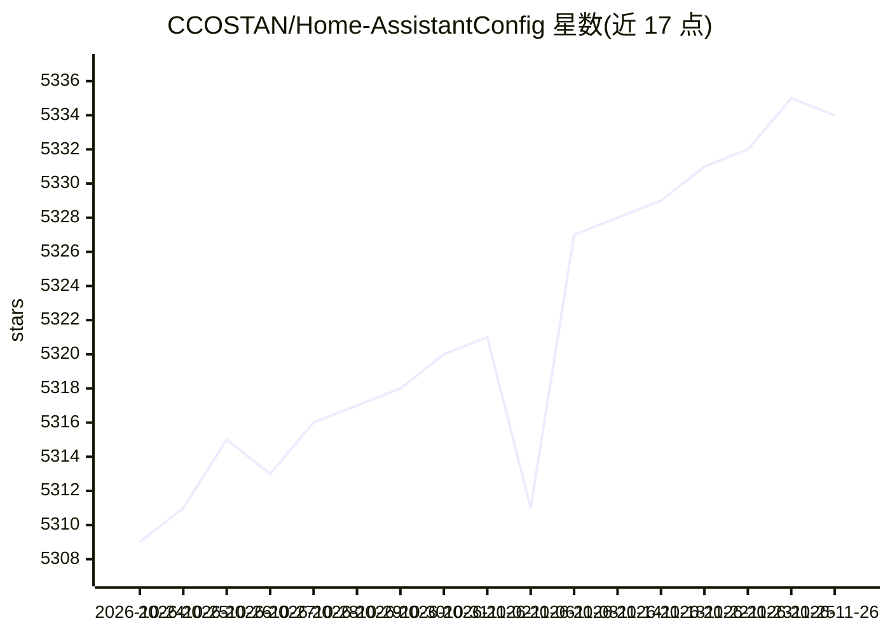

# CCOSTAN/Home-AssistantConfig

⭐ 5,334 · JavaScript · NOASSERTION · 推送 2026-11-24 · [GitHub](https://github.com/CCOSTAN/Home-AssistantConfig) · [官网](https://www.vCloudInfo.com) · 个人维护

**个人智能家居 Home Assistant 配置示例集，供浏览借鉴**

作者公开其住宅的 Home Assistant 实时配置，用于浏览与灵感参考，明示非一键部署方案；内容包括自动化、脚本、场景的 YAML 示例（夜间灯光、漏水响应、车库、特斯拉胎压告警、空气质量语音播报等），配套博客、YouTube 视频、硬件清单与 Affiliate 链接。配置以 Docker/compose 运行，GitHub Actions 校验公开 YAML；复用需自行替换实体 ID、密钥与本地端点。Issues 兼作变更日志与设计历史。

## 筛选速览

| 维度 | 判定 | 备注 |
|---|---|---|
| AI 角色 | `ai-knowledge` | 知识聚合/清单类 |
| 许可风险 | `none` | NOASSERTION |
| 部署形态 | `None` |  |
| 模型依赖 | — | README 未给出锁定关系 |
| 硬件要求 | — | 无带数字的原话,不猜 |
| 安装摩擦 | `low` | 无编译、无系统依赖或容器化 |
| 成熟度 | — | 结构信号不足 |

## 能力要点

- 覆盖照明、安防、车库、漏水、HVAC、太阳能、扫地机等真实自动化示例
- 配套博客文章与 YouTube 视频讲解各自动化实现
- 附带硬件清单（关联 Amazon Affiliate 链接）与购买说明
- GitHub Actions 持续校验公开的 YAML 示例与仪表盘

## 适用场景

- 参考真实家庭自动化的写法来搭建自己的 Home Assistant 配置
- 借鉴漏水自动断水、车库门提醒等具体场景的实现思路
- 挑选智能家居硬件前查看其与自动化的搭配实例

## 场景标签

`工作流自动化` `教程课程` · 领域:效率与自动化

## 证据(README 行号)

> L14: Live, personal Home Assistant configuration shared for **browsing and inspiration**. This is not a turnkey clone-an
> L32: - A live record of how my smart home runs, with real-world automations, scripts, and scenes.

## 星数曲线

2026-10-24 5,309 → 2026-11-26 5,334（+25）

---
*卡片 v1 · prompt 1.4 · 生成 2026-11-26 · 置信度 high · 依据 README sha `965baba82b43` · [字段定义](../../DATASET.md)*
