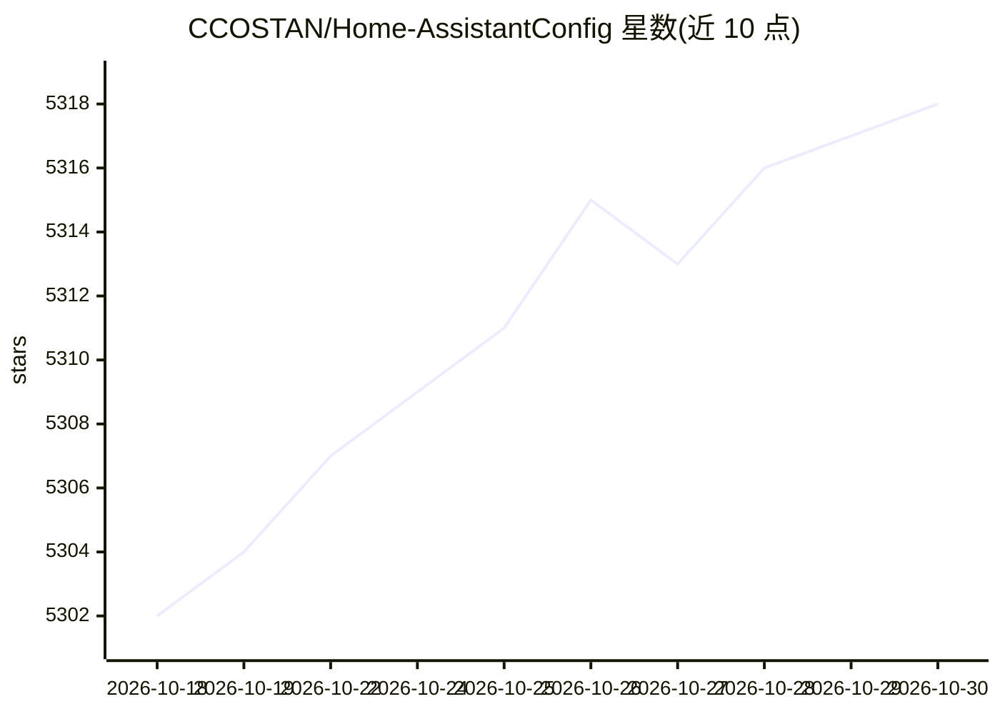

# CCOSTAN/Home-AssistantConfig

⭐ 5,318 · JavaScript · NOASSERTION · 推送 2026-10-28 · [GitHub](https://github.com/CCOSTAN/Home-AssistantConfig) · [官网](https://www.vCloudInfo.com) · 个人维护

**个人智能家居 Home Assistant 配置公开仓库：供浏览借鉴的实例与文档**

Bear Stone Smart Home 是博主公开维护的个人 Home Assistant 配置仓库：包含实际运行中的自动化、脚本、场景与仪表盘 YAML，覆盖警报监控、漏水响应、HVAC 维护、太阳能/电池、吸尘机器人、Frigate 车道停车与包裹检测等数十个场景，并配博客文章、视频与硬件清单（含返利链接）。仓库明确声明这是浏览参考用的实况记录而非可克隆即用的部署方案；平台运行于 Docker/compose，公开树仅含可复用配置，GitHub Actions 校验 YAML。另含可选的 Codex skills 页与 LLM Vision 实验记录，Issues 兼作变更日志与设计史。

## 筛选速览

| 维度 | 判定 | 备注 |
|---|---|---|
| AI 角色 | `ai-knowledge` | 知识聚合/清单类 |
| 许可风险 | `none` | NOASSERTION |
| 部署形态 | `None` |  |
| 模型依赖 | — | README 未给出锁定关系 |
| 硬件要求 | — | 无带数字的原话,不猜 |
| 安装摩擦 | `low` | 无编译、无系统依赖或容器化 |
| 成熟度 | — | 结构信号不足 |

## 能力要点

- 数十个真实运行的家庭自动化 YAML 示例（警报、漏水、HVAC、太阳能、真空吸尘等）
- 每项配置配套博客文章、视频与硬件购买说明
- GitHub Actions 持续校验公开 YAML 与仪表盘
- Frigate 车道停车/包裹检测与 LLM Vision 实验记录

## 适用场景

- 搭建自己的 Home Assistant 时参考现成的自动化模式
- 按硬件清单了解某类设备（智能锁、洒水器、水阀）如何接入自动化
- 浏览 Issues 了解配置变更背后的设计原因

## 场景标签

`工作流自动化` · 领域:效率与自动化

## 证据(README 行号)

> L14: Live, personal Home Assistant configuration shared for **browsing and inspiration**. This is not a turnkey clone-an
> L30: - A live record of how my smart home runs, with real-world automations, scripts, and scenes.

## 星数曲线

2026-10-18 5,302 → 2026-10-30 5,318（+16）

---
*卡片 v1 · prompt 1.4 · 生成 2026-10-20 · 置信度 mid · 依据 README sha `75f6bce38a8c` · [字段定义](../../DATASET.md)*
