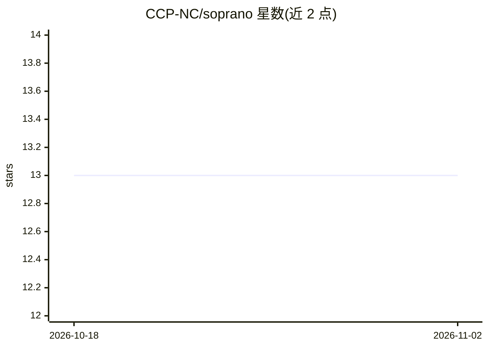

# CCP-NC/soprano

⭐ 13 · Jupyter Notebook · LGPL-3.0 · 推送 2026-10-15 · [GitHub](https://github.com/CCP-NC/soprano) · [官网](https://ccp-nc.github.io/soprano/) · 组织维护

**计算晶体学与 NMR 分析的 Python 库，面向晶体结构大数据集**

由 CCP for NMR Crystallography 开发维护的 Python 库，帮助从事晶体学与模拟的科研人员生成、处理、计算和分析大规模晶体结构数据集，重点关注 AIRSS（从头随机结构搜索）输出。功能包括 AtomsCollection 批量结构处理、周期性边界的原子间距计算、.magres NMR 参数处理与粉末谱近似、基于 SciPy 层次聚类与 k-means 的结构分类（phylogen 模块），以及可向 HPC 队列系统提交计算的 Submitter 类。对称性分析需可选安装 spglib 或 moyopy 后端。

## 筛选速览

| 维度 | 判定 | 备注 |
|---|---|---|
| AI 角色 | `ai-enhanced` | 去掉 AI 部分产品仍成立 |
| 许可风险 | `viral` | LGPL-3.0 |
| 部署形态 | `library` | 以包/库形式分发 |
| 模型依赖 | — | README 未给出锁定关系 |
| 硬件要求 | — | 无带数字的原话,不猜 |
| 安装摩擦 | `low` | 无编译、无系统依赖或容器化 |
| 成熟度 | — | 结构信号不足 |

## 能力要点

- AtomsCollection 批量处理结构数据集并提取化学/结构属性
- 读取 .magres NMR 参数并计算四极/偶极耦合与粉末谱近似
- phylogen 模块用层次聚类与 k-means 分类结构集合
- Submitter 类支持向远程 HPC 队列系统提交计算并回收结果

## 适用场景

- 分析 AIRSS 搜索产出的候选晶体结构集合
- 从 .magres 文件计算 NMR 参数并模拟粉末谱
- 对大量结构做聚类以寻找多晶型或缺陷位点
- 批量向 HPC 集群提交计算并自动回收结果

## 场景标签

`科研工具` · 领域:学习与行业

## 证据(README 行号)

> L9: Soprano is a Python library developed and maintained by the CCP for NMR Crystallography as a tool to help scientists
> L130: ### Machine learning and phylogenetic analysis
> L131: The `soprano.analyse.phylogen` module contains functionality to classify collections of structures based on releva

## 星数曲线

2026-10-18 13 → 2026-11-02 13（+0）

---
*卡片 v1 · prompt 1.4 · 生成 2026-10-31 · 置信度 high · 依据 README sha `8df9c0e4a49b` · [字段定义](../../DATASET.md)*
