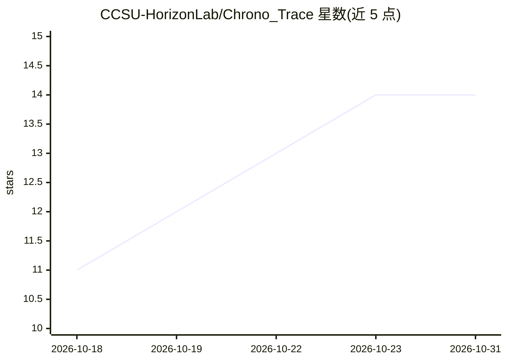

# CCSU-HorizonLab/Chrono_Trace

⭐ 14 · Python · NOASSERTION · 推送 2026-10-30 · [GitHub](https://github.com/CCSU-HorizonLab/Chrono_Trace) · 组织维护 · 中文 README

**微信 PC 4.x 聊天记录本地分析与 AI 沟通建议桌面工具**

基于 PyWebView + Vue 3 + Python 的 Windows/Linux 桌面应用，面向微信 4.x 用户：解密并导入本地聊天数据库，提供情绪分析、好感度评分（四维+LLM）、关系章节分段、大五人格演变、聊天导出（TXT/CSV/HTML）、对聊天记录的自然语言问答，以及联系人长期记忆（RAG）与实时监听 + LLM 回复建议。解密、导入、分析默认在本机完成；仅启用 LLM 建议时发送上下文至所配置模型，远程调用前逐条脱敏。安装包内置本地推理模型（ONNX Runtime / DirectML，免 CUDA）。采用 PolyForm Noncommercial 非商业授权，UI 与文档仅中文。

## 筛选速览

| 维度 | 判定 | 备注 |
|---|---|---|
| AI 角色 | `ai-native` | 本体是模型或模型工具 |
| 许可风险 | `none` | NOASSERTION |
| 部署形态 | `desktop` | 安装包/桌面程序 |
| 模型依赖 | local-ok | 支持本地模型 |
| 硬件要求 | — | 无带数字的原话,不猜 |
| 安装摩擦 | `medium` | 含编译或系统依赖之一 |
| 成熟度 | — | 结构信号不足 |

## 能力要点

- 内置密钥登录捕获，微信 4.x 数据解密、导入、分析全程本机完成
- 好感度「四维 + LLM」评分与双证据风险预警
- 联系人长期记忆（RAG）：事实抽取、演变链、纠错闭环与全链路可观测
- 聊天记录导出 TXT/CSV/HTML，回答附引用可溯源

## 适用场景

- 导入微信聊天记录做情绪趋势、好感度与关系分析
- 聊天时开启实时监听获取 LLM 回复建议与参考话术
- 对某个联系人的聊天记录做自然语言问答
- 导出聊天记录为可读文件存档或二次分析

## 场景标签

`Agent 记忆` `RAG` `文档问答` · 领域:Agent 开发

## 证据(README 行号)

> L5: > 面向微信 PC 4.x 聊天记录的本地分析与实时辅助桌面工具——数据不出本机。
> L30: - 实时监听与 AI 沟通建议
> L31: - 联系人长期记忆（RAG）：事实抽取、演变维护与纠错闭环

## 星数曲线

2026-10-18 11 → 2026-10-31 14（+3）

---
*卡片 v1 · prompt 1.4 · 生成 2026-10-31 · 置信度 mid · 依据 README sha `fa2fbaad4866` · [字段定义](../../DATASET.md)*
