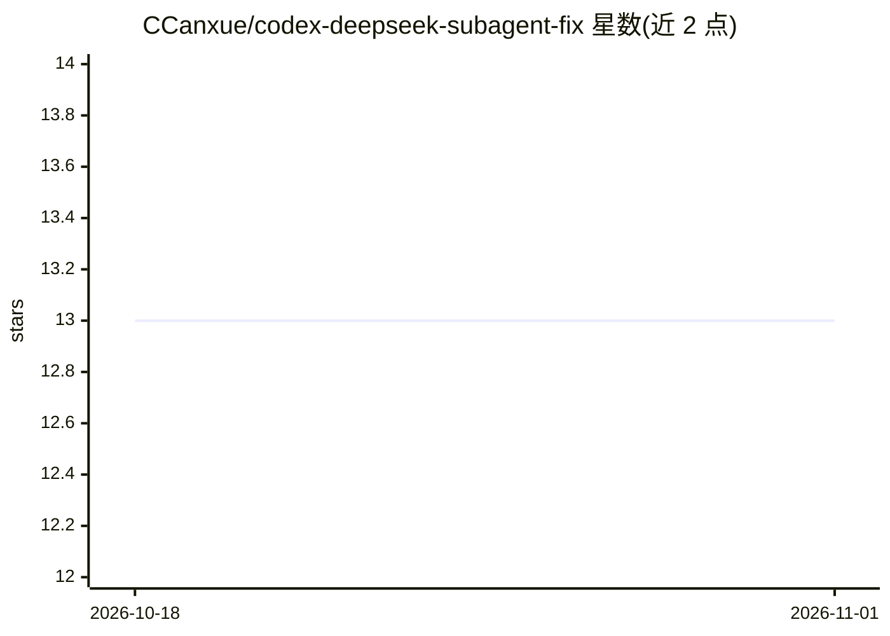

# CCanxue/codex-deepseek-subagent-fix

⭐ 13 · Shell · Apache-2.0 · 推送 2026-08-17 · [GitHub](https://github.com/CCanxue/codex-deepseek-subagent-fix) · 个人维护

**让 Codex MultiAgentV2 子代理任务兼容 DeepSeek 的补丁版 CLI**

对 OpenAI Codex CLI 打补丁后重新发布的 codex-ds 命令：Codex MultiAgentV2 将子代理任务放在 agent_message 的 encrypted_content 中由 OpenAI 服务端解密，DeepSeek 的 Responses 实现不消费该字段，导致子代理收不到任务；补丁在非 OpenAI 提供商下改为以普通 user message 交付任务，使 spawn_agent、followup_task、send_message 可用。支持 deepseek-v4-flash/pro 作为主代理与子代理模型。仅发布 Linux x86_64 二进制，安装脚本装至 ~/.local/bin，附带 SHA256 与 cosign 签名（当前已发布版本早于签名流程）。

## 筛选速览

| 维度 | 判定 | 备注 |
|---|---|---|
| AI 角色 | `ai-ecosystem` | LLM/agent 周边工具 |
| 许可风险 | `permissive` | Apache-2.0 |
| 部署形态 | `None` |  |
| 模型依赖 | locked-api |  |
| 硬件要求 | — | 无带数字的原话,不猜 |
| 安装摩擦 | `low` | 无编译、无系统依赖或容器化 |
| 成熟度 | `idea` | |

## 能力要点

- 补丁使非 OpenAI 提供商的子代理任务以 user message 交付
- 支持 deepseek-v4-flash / deepseek-v4-pro 作为主代理与子代理
- 独立 codex-ds 命令，不影响已有 Codex 安装
- 发布附带 SHA256、cosign 签名与 GitHub 构建溯源（当前已发布版本尚无签名资产）

## 适用场景

- 在 Codex MultiAgentV2 中用 DeepSeek 跑多代理子任务
- 官方二进制下子代理报 agent thread limit reached 时改用补丁版
- 给非 OpenAI Responses 提供商适配 Codex 子代理机制

## 场景标签

`多智能体` `编码 Agent` · 领域:Agent 开发

## 证据(README 行号)

> L11: Codex MultiAgentV2 sends subagent tasks inside the `encrypted_content` of an `agent_message` item. OpenAI decrypts 
> L66: To build it yourself on Linux x86_64 with Rust and Git installed:

## 星数曲线

2026-10-18 13 → 2026-11-01 13（+0）

---
*卡片 v1 · prompt 1.4 · 生成 2026-10-31 · 置信度 high · 依据 README sha `49e8c890d8bc` · [字段定义](../../DATASET.md)*
