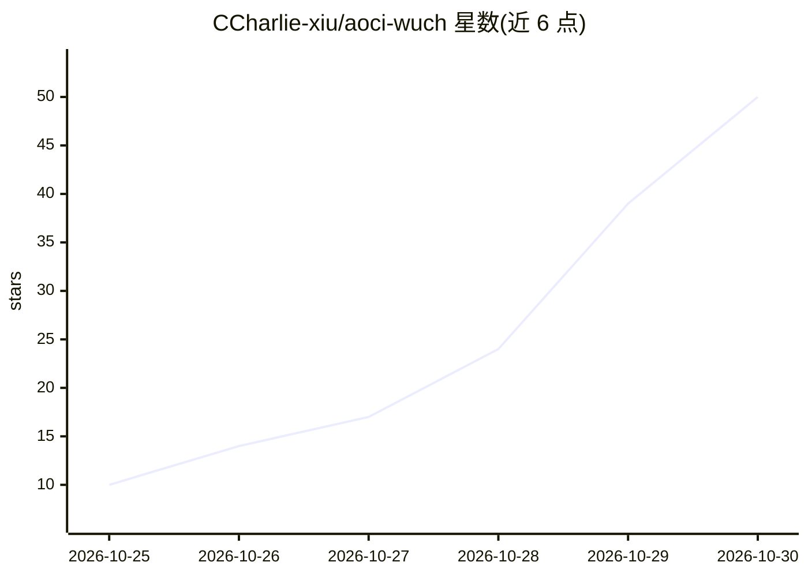

# CCharlie-xiu/aoci-wuch

⭐ 50 · Python · NOASSERTION · 推送 2026-10-28 · [GitHub](https://github.com/CCharlie-xiu/aoci-wuch) · [官网](https://skill.wuch-ai.net/) · 个人维护 · 中文 README

**面向 AI 编程代理的任务优先技能库**

以任务为索引组织的 agent 技能库：按『用户任务→读目录→匹配→仅加载命中指南』的方式供 AI 编程助手按需读取，避免一次性灌入全部内容。技能分 Stable 与 Experimental 两级，覆盖 GitHub 授权、移动端应用、Excel 后端、视频抽帧、UI 风格设计、SSO 等类别；公共技能托管于 GitHub，另有通过订阅鉴权获取的 PRO 技能。安装方式是将仓库作为可复用 Agent Skill 引入（如 Cursor），并提供本地校验与更新脚本。许可证为保留所有权利，仅限个人查看与使用，不接受外部贡献。

## 筛选速览

| 维度 | 判定 | 备注 |
|---|---|---|
| AI 角色 | `ai-knowledge` | 知识聚合/清单类 |
| 许可风险 | `none` | NOASSERTION |
| 部署形态 | `None` |  |
| 模型依赖 | — | README 未给出锁定关系 |
| 硬件要求 | — | 无带数字的原话,不猜 |
| 安装摩擦 | `low` | 无编译、无系统依赖或容器化 |
| 成熟度 | `idea` | |

## 能力要点

- 任务→目录→单技能的按需加载索引机制
- Stable / Experimental 双索引区分成熟度
- 免费公共技能 + 订阅制 PRO 技能（站点鉴权）
- 提供 validate.py 校验与 update_skills.py 更新脚本

## 适用场景

- 为 Cursor 等 AI 编程助手安装可复用技能库
- 让助手按任务匹配并只加载所需工作流指南
- 订阅获取 PRO 技能（移动端模板、TestFlight 发布等）

## 场景标签

`提示工程` · 领域:Agent 开发

## 证据(README 行号)

> L9: **A task-first skill library for AI coding agents.**
> L41: User task → Read catalog → Select a match → Load its guide → Do the work

## 星数曲线

2026-10-25 10 → 2026-10-30 50（+40）

---
*卡片 v1 · prompt 1.4 · 生成 2026-10-28 · 置信度 high · 依据 README sha `d36f186e78bc` · [字段定义](../../DATASET.md)*
