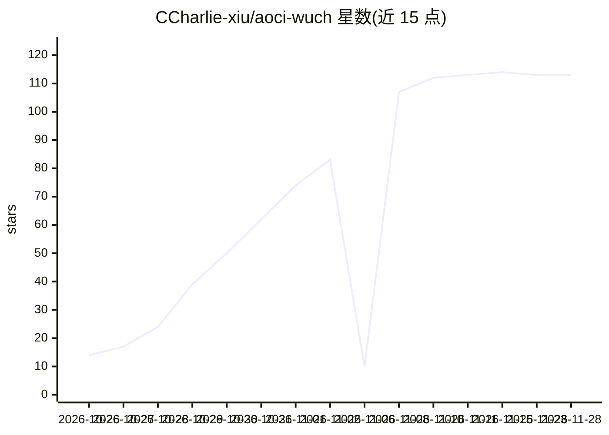

# CCharlie-xiu/aoci-wuch

⭐ 113 · JavaScript · NOASSERTION · 推送 2026-11-25 · [GitHub](https://github.com/CCharlie-xiu/aoci-wuch) · [官网](https://skill.wuch-ai.net/) · 个人维护 · 中文 README

**面向 AI 编码 agent 的任务优先技能库**

为 AI 编码助手设计的可复用技能库：收录工作流、推理方法、MCP 配置、UI 设计、移动端、Excel、视频处理等能力，通过目录索引机制让助手按任务匹配条目、只加载命中的指南而非全量注入上下文。技能分 Stable 与 Experimental 两级标注成熟度；公开技能托管在 GitHub，PRO 技能需经站点订阅认证后使用。安装方式为将仓库作为 Agent Skill 装入 Cursor 等支持 SKILL.md 的助手，附本地校验与更新脚本。

## 筛选速览

| 维度 | 判定 | 备注 |
|---|---|---|
| AI 角色 | `ai-knowledge` | 知识聚合/清单类 |
| 许可风险 | `none` | NOASSERTION |
| 部署形态 | `None` |  |
| 模型依赖 | — | README 未给出锁定关系 |
| 硬件要求 | — | 无带数字的原话,不猜 |
| 安装摩擦 | `low` | 无编译、无系统依赖或容器化 |
| 成熟度 | — | 结构信号不足 |

## 能力要点

- 任务→目录→命中单个技能的按需加载机制
- Stable/Experimental 双索引标注技能成熟度
- GitHub 公开技能 + 站点订阅 PRO 技能的分发模式
- 提供 validate.py 校验与 update_skills.py 增量更新脚本

## 适用场景

- 为 Cursor 等 agent 安装可复用的编码技能集
- 让 AI 助手按任务自动匹配并加载对应工作流指南
- 查阅 MCP 数据库接入、UI 风格生成等能力的操作指南

## 场景标签

`提示工程` · 领域:Agent 开发

## 证据(README 行号)

> L9: **A task-first skill library for AI coding agents.**
> L11: Reusable workflows, reasoning methods, MCP setup, UI design, mobile, Excel, and video—indexed so the assistant find
> L44: The assistant should **not** load every capability body up front. Use capabilities/index.md (and the experimental i

## 星数曲线

2026-10-26 14 → 2026-11-28 113（+99）

---
*卡片 v1 · prompt 1.4 · 生成 2026-11-28 · 置信度 high · 依据 README sha `8195cc41f8d0` · [字段定义](../../DATASET.md)*
