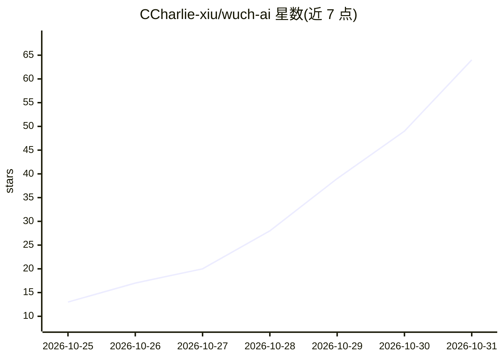

# CCharlie-xiu/wuch-ai

⭐ 64 · JavaScript · MIT · 推送 2026-10-23 · [GitHub](https://github.com/CCharlie-xiu/wuch-ai) · [官网](https://wuch-ai.net) · 个人维护 · 中文 README

**对话生成可交互画布 UI 的 Web 应用**

聊天面板输入一句话，左侧画布流式渲染出图表、表格、地图等交互界面；滑块、复选框等控件在本地就地更新，无需额外模型调用。支持多模型端点切换、图片/表格/文档附件、对话中蒸馏知识条目并按索引检索、工具预算与上下文压缩。提供托管站点 wuch-ai.net 与本地运行方式（bun install / bun run dev，可选 mock 上游无 key 体验），可部署到 Cloudflare Workers；设置中填写 OpenAI 兼容 base URL 与 API key。

## 筛选速览

| 维度 | 判定 | 备注 |
|---|---|---|
| AI 角色 | `ai-native` | 本体是模型或模型工具 |
| 许可风险 | `permissive` | MIT |
| 部署形态 | `None` |  |
| 模型依赖 | — | README 未给出锁定关系 |
| 硬件要求 | — | 无带数字的原话,不猜 |
| 安装摩擦 | `low` | 无编译、无系统依赖或容器化 |
| 成熟度 | — | 结构信号不足 |

## 能力要点

- 自然语言生成画布 UI，流式渲染图表/表格/地图等控件
- 控件本地就地编辑，无需额外模型往返
- 知识条目蒸馏与按索引检索，上下文近限时压缩
- 支持 OpenAI 兼容端点切换与无 key 的 mock/demo 回放模式

## 适用场景

- 用一句话生成销售看板或产品数据面板并继续对话细化
- 导入 Excel 表格后对话式分析目标与预算
- 无 API key 时通过 demo 回放预览生成式界面效果

## 场景标签

`聊天机器人` `数据分析` · 领域:效率与自动化

## 证据(README 行号)

> L13: **Say what you want — the UI grows on the canvas.**
> L27: |Natural language → interactive UI|Say “build a Q3 sales page” and charts, tables, and controls appear on the left|
> L60: |`/`|Live UI left, chat right; set model base URL and key in Settings|

## 星数曲线

2026-10-25 13 → 2026-10-31 64（+51）

---
*卡片 v1 · prompt 1.4 · 生成 2026-10-28 · 置信度 high · 依据 README sha `1f5f9d03b40c` · [字段定义](../../DATASET.md)*
