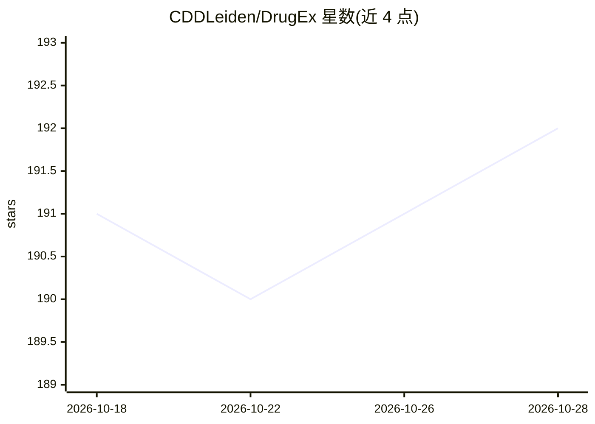

# CDDLeiden/DrugEx

⭐ 192 · Jupyter Notebook · MIT · 推送 2026-10-15 · [GitHub](https://github.com/CDDLeiden/DrugEx) · [官网](https://cddleiden.github.io/DrugEx/docs/) · 组织维护

**深度学习多目标强化学习的小分子从头设计库，面向药物发现研究者**

莱顿大学 Computational Drug Discovery 组维护的开源 Python 库，通过深度生成模型在多目标强化学习框架下从头设计小分子：包含 RNN（GRU/LSTM）与基于 Transformer 的生成器架构、分子标准化/清洗/编码工具、多种打分与多目标优化方法。提供统一 Python API 与命令行接口，附 Jupyter 教程；在 Zenodo 与 ChEMBL 上发布预训练模型。打分用 QSAR 模型拆分到 QSPRpred 包，作为可选依赖。全量模型需 CUDA 9.2 兼容 GPU 且显存至少 8 GB，Transformer 训练推荐多 GPU 并行。

## 筛选速览

| 维度 | 判定 | 备注 |
|---|---|---|
| AI 角色 | `ai-native` | 本体是模型或模型工具 |
| 许可风险 | `permissive` | MIT |
| 部署形态 | `library` | 以包/库形式分发 |
| 模型依赖 | — | README 未给出锁定关系 |
| 硬件要求 | — | 无带数字的原话,不猜 |
| 安装摩擦 | `medium` | 含编译或系统依赖之一 |
| 成熟度 | `idea` | |

## 能力要点

- 多目标强化学习框架下的分子生成，含 RNN（GRU/LSTM）与图/SMILES Transformer 架构
- 分子标准化、清洗与编码工具及训练监控功能
- 提供预训练模型（ChEMBL 27/31、Papyrus 05.5，Zenodo 下载）
- 支持多 GPU 并行训练与命令行/Python API 两种使用方式

## 适用场景

- 药物发现研究中生成聚焦特定目标的小分子化合物库
- 按特定子结构约束进行骨架约束的分子设计
- 使用预训练模型在新目标上做强化学习微调与优化

## 场景标签

`强化学习` · 领域:训练与推理

## 证据(README 行号)

> L3: DrugEx is an open-source software library for de novo design of small molecules with deep learning generative models
> L7: This software is a continuation of the original and incremental work of Liu et al.'s DrugEx [2,3,4] and is currently

## 星数曲线

2026-10-18 191 → 2026-10-28 192（+1）

---
*卡片 v1 · prompt 1.4 · 生成 2026-10-22 · 置信度 high · 依据 README sha `11ba20f8c70d` · [字段定义](../../DATASET.md)*
