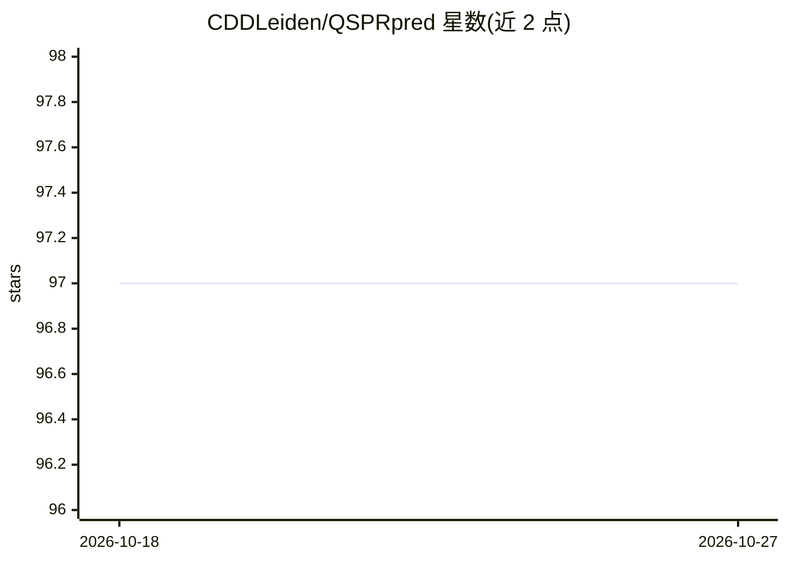

# CDDLeiden/QSPRpred

⭐ 97 · Jupyter Notebook · MIT · 推送 2026-09-11 · [GitHub](https://github.com/CDDLeiden/QSPRpred) · [官网](https://cddleiden.github.io/QSPRpred/docs/) · 组织维护

**构建 QSPR/QSAR 定量构效关系模型的化学信息学库**

由 Leiden 大学 Computational Drug Discovery 组（Gerard van Westen 团队）开发的开源 Python 库，为构建定量构效/构性关系（QSPR/QSAR）模型提供统一接口，支持多种描述符与机器学习算法。内部依赖 RDKit 与 scikit-learn，模型序列化使用 ml2json，可与 Papyrus 数据集互操作获取数据，产出的模型兼容 DrugEx 从头药物设计包。提供命令行界面与 Python API，含 Jupyter notebook 教程；可选安装 deep learning（torch/chemprop）等扩展依赖。

## 筛选速览

| 维度 | 判定 | 备注 |
|---|---|---|
| AI 角色 | `ai-native` | 本体是模型或模型工具 |
| 许可风险 | `permissive` | MIT |
| 部署形态 | `library` | 以包/库形式分发 |
| 模型依赖 | — | README 未给出锁定关系 |
| 硬件要求 | — | 无带数字的原话,不猜 |
| 安装摩擦 | `medium` | 含编译或系统依赖之一 |
| 成熟度 | `idea` | |

## 能力要点

- 统一接口构建基于多种描述符与算法的 QSPR/QSAR 模型
- 与 Papyrus 生物活性数据集互操作，模型兼容 DrugEx
- 提供 CLI 与 Python API 两种使用方式
- 可选扩展：PCM 模型、深度学习模型（torch/chemprop）

## 适用场景

- 我在药物发现研究中构建和复现 QSAR 模型
- 我需要用统一接口对比不同描述符和机器学习算法
- 我要把训练好的模型接入从头药物设计流程（DrugEx）

## 场景标签

 · 领域:药物发现/化学信息学

## 证据(README 行号)

> L7: QSPRpred is open-source software libary for building **Quantitative Structure Property/Activity
> L9: Discovery group. It provides a unified interface for building QSPR models based on

## 星数曲线

2026-10-18 97 → 2026-10-27 97（+0）

---
*卡片 v1 · prompt 1.4 · 生成 2026-10-23 · 置信度 high · 依据 README sha `fe3aebf1f176` · [字段定义](../../DATASET.md)*
