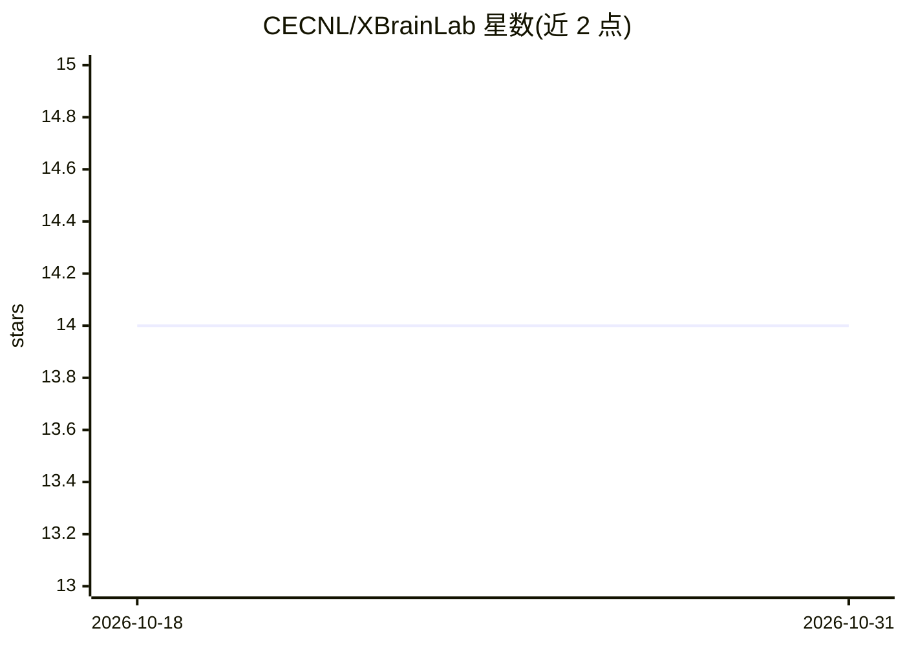

# CECNL/XBrainLab

⭐ 14 · Python · GPL-3.0 · 推送 2025-12-05 · [GitHub](https://github.com/CECNL/XBrainLab) · [官网](https://docs.google.com/presentation/d/1GoPNo0FKgotTUpPmYyAzRrkXfdhufbOtzasi6yyeJic/edit?usp=sharing) · 组织维护

**面向神经科学发现的 EEG 深度学习解码工具箱**

XBrainLab 是基于深度学习的 EEG 解码工具箱，面向神经科学研究者。提供 GUI 应用，终端输入 XBrainLab 即可启动，也可在 Python 控制台调用。内置多个 EEG 模型实现（EEGNet、SCCNet、ShallowConvNet 等），结合可解释 AI（captum）方法分析脑电神经模式，基于 MNE 与 PyTorch 构建。通过 pip 从 GitHub 源码安装，要求 Python 3.9+。文档状态为 TBD，论文引用请示于 README。

## 筛选速览

| 维度 | 判定 | 备注 |
|---|---|---|
| AI 角色 | `ai-native` | 本体是模型或模型工具 |
| 许可风险 | `viral` | GPL-3.0 |
| 部署形态 | `library` | 以包/库形式分发 |
| 模型依赖 | — | README 未给出锁定关系 |
| 硬件要求 | — | 无带数字的原话,不猜 |
| 安装摩擦 | `low` | 无编译、无系统依赖或容器化 |
| 成熟度 | — | 结构信号不足 |

## 能力要点

- 深度学习 EEG 解码，面向神经科学发现
- GUI 应用与 Python API 两种使用方式
- 内置 EEGNet、SCCNet、ShallowConvNet 等模型实现
- 结合可解释 AI（captum）进行神经模式解释

## 适用场景

- 对 EEG 数据做深度学习解码与分类
- 用可解释方法分析脑电神经模式
- 在 GUI 中交互式开展 EEG 分析实验

## 场景标签

`科研工具` · 领域:学习与行业

## 证据(README 行号)

> L5: XBrainLab is a EEG decoding toolbox with deep learning dedicated to neuroscience discoveries.
> L38: title={{XB}rainLab: An Open-Source Software for Explainable Artificial Intelligence-Based {EEG} Analysis},

## 星数曲线

2026-10-18 14 → 2026-10-31 14（+0）

---
*卡片 v1 · prompt 1.4 · 生成 2026-10-31 · 置信度 high · 依据 README sha `c7cfb62da4ba` · [字段定义](../../DATASET.md)*
