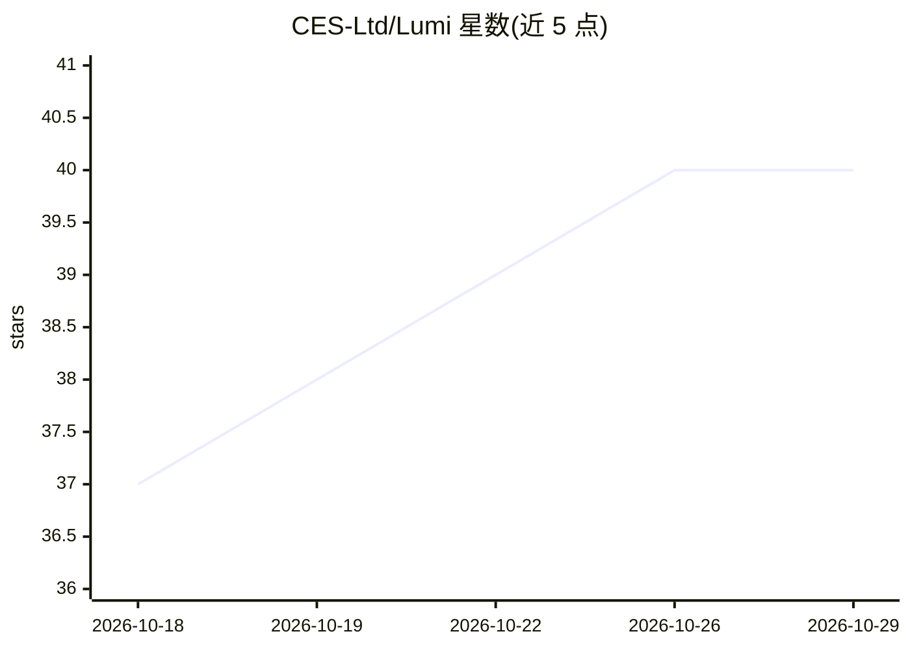

# CES-Ltd/Lumi

⭐ 40 · Rust · MIT · 推送 2026-05-11 · [GitHub](https://github.com/CES-Ltd/Lumi) · 组织维护

**Rust 桌面 AI agent 平台：统一运行 Claude Code 等多 agent**

以 Rust + GPUI 实现的单二进制桌面应用（lumi-gpui），通过 MCP 驱动逐团队的 Claude Code 实例做工具调用，可配合 Claude、Crush、GeminiCLI、Hermes、Cursor 运行。底座为 lumi-* crate 群，覆盖存储/记忆/调度/策略/审计/计价/定时任务/技能。界面含十个任务面：聊天、协作、代码浏览与 diff、ComfyUI 控制、记忆（观察/情节/知识图谱）、分析看板、看板 Sprint、计划、agent 名册与设置。限制：无预编译安装包，需从源码用 cargo 构建运行。

## 筛选速览

| 维度 | 判定 | 备注 |
|---|---|---|
| AI 角色 | `ai-ecosystem` | LLM/agent 周边工具 |
| 许可风险 | `permissive` | MIT |
| 部署形态 | `None` |  |
| 模型依赖 | locked-api |  |
| 硬件要求 | — | 无带数字的原话,不猜 |
| 安装摩擦 | `low` | 无编译、无系统依赖或容器化 |
| 成熟度 | — | 结构信号不足 |

## 能力要点

- GPUI 单二进制承载十个任务面（Chat/Cowork/Code/Memory/Analytics/Sprint 等）
- 通过 MCP 驱动逐团队 Claude Code 实例，含九个进程内 MCP server
- lumi-* crate 覆盖存储、记忆、调度、策略、审计、计价、cron、技能
- 状态目录 ~/.lumi-lyra/ 含团队注册、审计 JSONL、可选 state-git 版本化

## 适用场景

- 在桌面端统一管理与运行多团队 AI agent 对话
- 跟踪每个团队的 token 消耗与 USD 成本并审计日志
- 维护 agent 的长期记忆（观察、情节、知识图谱）

## 场景标签

`Agent 框架` `多智能体` `Agent 记忆` · 领域:Agent 开发

## 证据(README 行号)

> L3: Native desktop AI agent platform written in Rust. It can run with Claude, Crush, GeminiCLI, HERMES, CURSOR
> L4: Cargo workspace with a GPUI shell on top, a fleet of `lumi-*` crates for storage / memory / dispatch / policy / audi

## 星数曲线

2026-10-18 37 → 2026-10-29 40（+3）

---
*卡片 v1 · prompt 1.4 · 生成 2026-10-25 · 置信度 high · 依据 README sha `7990e48f6969` · [字段定义](../../DATASET.md)*
