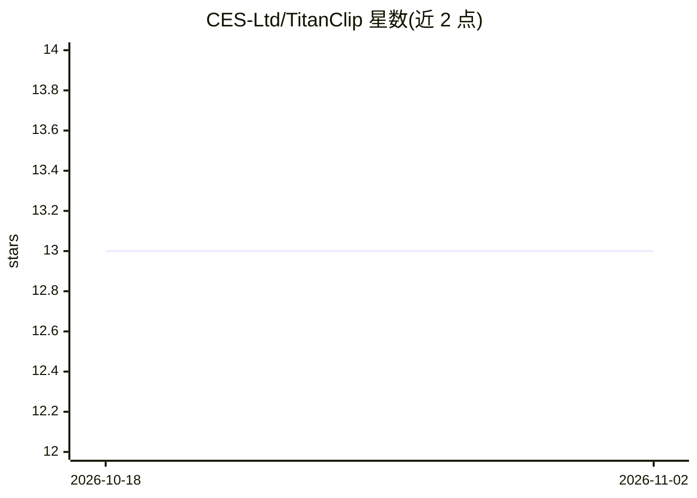

# CES-Ltd/TitanClip

⭐ 13 · TypeScript · 推送 2026-04-10 · [GitHub](https://github.com/CES-Ltd/TitanClip) · [官网](https://ces-ltd.github.io/titanclip.ai/) · 组织维护

**企业级自主 AI 代理团队编排平台（Electron 桌面应用）**

基于 Paperclip 开源项目构建的桌面端 AI 代理团队编排平台，以 Electron 33 + React 19 + 内嵌 PostgreSQL 实现。功能包括代理雇佣与角色化任务路由、Kanban 问题跟踪、heartbeat 队列唤醒编排、9 种模型适配器（Claude/Codex/Cursor/Gemini 等）、AES-256-GCM 加密的凭据保险库与短时 JWT 的运行时代理 IAM、自治级别控制（sandboxed/supervised/autonomous）、提示注入检测、成本归因与审计导出。macOS 提供 DMG 安装包（捆绑 Node.js v22），亦可从源码构建。仅面向 macOS arm64 发布安装包。

## 筛选速览

| 维度 | 判定 | 备注 |
|---|---|---|
| AI 角色 | `ai-ecosystem` | LLM/agent 周边工具 |
| 许可风险 | `none` | — |
| 部署形态 | `desktop` | 安装包/桌面程序 |
| 模型依赖 | locked-api |  |
| 硬件要求 | — | 无带数字的原话,不猜 |
| 安装摩擦 | `low` | 无编译、无系统依赖或容器化 |
| 成熟度 | `idea` | |

## 能力要点

- 运行时代理 IAM：短时 HS256 JWT、角色化任务路由、逐次调用审计
- AES-256-GCM 凭据保险库，代理仅获 TTL 定时令牌不接触原始密钥
- 9 种模型适配器（Claude、Codex、Cursor、Gemini、OpenAI 兼容等）
- heartbeat 队列编排与三级自治级别（沙箱/受监督/全自治）

## 适用场景

- 以受控方式部署多代理团队处理项目任务与问题跟踪
- 对自主 AI 代理的密钥访问与操作做企业级审计与成本归因
- 通过 Kanban 与聊天界面对代理团队进行任务分派与审批

## 场景标签

`多智能体` · 领域:Agent 开发

## 证据(README 行号)

> L6:  Deploy teams of autonomous AI agents that collaborate, delegate, and deliver — governed by enterprise-grade securit
> L60: |**Multi-Adapter Support**|9 adapters: Claude, Codex, Cursor, Gemini, OpenCode, Pi, OpenClaw Gateway, Universal LLM

## 星数曲线

2026-10-18 13 → 2026-11-02 13（+0）

---
*卡片 v1 · prompt 1.4 · 生成 2026-10-31 · 置信度 mid · 依据 README sha `ac393145470a` · [字段定义](../../DATASET.md)*
