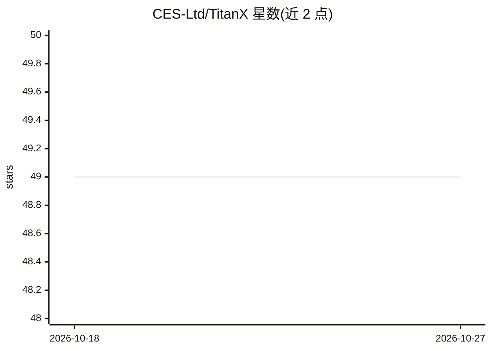

# CES-Ltd/TitanX

⭐ 49 · TypeScript · Apache-2.0 · 推送 2026-04-21 · [GitHub](https://github.com/CES-Ltd/TitanX) · [官网](https://github.com/CES-Ltd/TitanX) · 组织维护

**企业级桌面端多 AI agent 编排与治理平台**

基于 Electron/React/TypeScript 的桌面应用，构建于开源 AionUI 平台之上，用于编排多 agent 团队：Lead agent 协调 teammates、MCP 工具服务器、34 个预置 agent 模板、n8n 风格 DAG 工作流引擎、LangChain 风格 agent 记忆、DeepAgents 风格任务规划，以及 IAM 策略、HMAC 签名审计日志、LangSmith 兼容 trace、OpenTelemetry 关联等企业安全与可观测能力。支持 Claude、GPT、Gemini、Ollama 等 20+ LLM 提供商。v2.4 引入 Fleet Mode（Alpha，声明将有破坏性变更），支持 Master/Slave 多设备管控。从源码运行。

## 筛选速览

| 维度 | 判定 | 备注 |
|---|---|---|
| AI 角色 | `ai-ecosystem` | LLM/agent 周边工具 |
| 许可风险 | `permissive` | Apache-2.0 |
| 部署形态 | `library` | 以包/库形式分发 |
| 模型依赖 | local-ok | 支持本地模型 |
| 硬件要求 | — | 无带数字的原话,不猜 |
| 安装摩擦 | `medium` | 含编译或系统依赖之一 |
| 成熟度 | `idea` | |

## 能力要点

- Lead agent 协调的多 agent 团队编排，支持运行时动态招募与重启自动恢复
- IAM 策略、HMAC 签名审计日志、Blueprints 安全配置等企业治理功能
- n8n 风格 DAG 工作流引擎（8 种节点类型、审批门、执行历史）
- LangSmith 兼容 trace 与 OpenTelemetry span 关联的成本/用量追踪
- Fleet Mode（Alpha）：Master 签名命令与配置分发、Slave 遥测回传

## 适用场景

- 企业内以统一控制面运行和治理多 agent 数字劳动力
- 为 agent 配置细粒度工具权限并留存不可变审计记录
- 追踪 agent 团队的 token 用量、成本与执行 trace
- 跨多台设备集中下发 IAM 策略与 agent 模板（Fleet Mode）

## 场景标签

`Agent 框架` `多智能体` `工作流自动化` `LLM 可观测性` · 领域:Agent 开发

## 证据(README 行号)

> L45: **TitanX** is an enterprise-grade desktop application for AI agent orchestration. It transforms teams of AI agents 
> L47: > Built on the open-source AionUI platform, TitanX adds enterprise security (inspired by NVIDIA NemoClaw), workflow

## 星数曲线

2026-10-18 49 → 2026-10-27 49（+0）

---
*卡片 v1 · prompt 1.4 · 生成 2026-10-25 · 置信度 mid · 依据 README sha `20a7ab3bea7e` · [字段定义](../../DATASET.md)*
