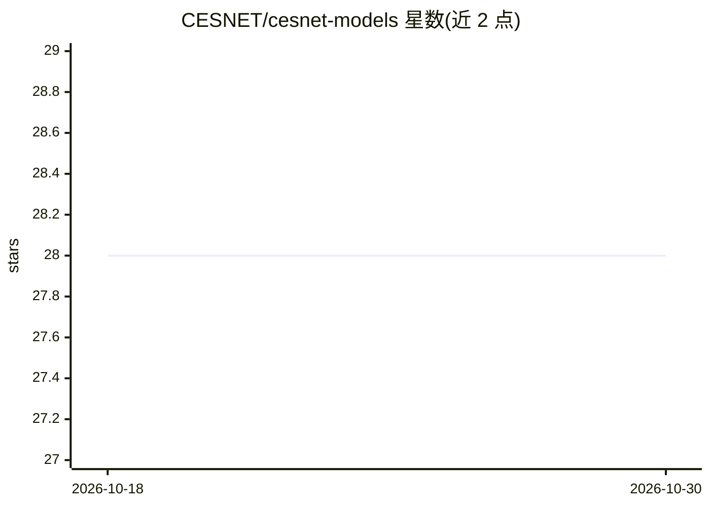

# CESNET/cesnet-models

⭐ 28 · Python · BSD-3-Clause · 推送 2026-03-23 · [GitHub](https://github.com/CESNET/cesnet-models) · [官网](https://cesnet.github.io/cesnet-models/) · 组织维护

**网络流量分类的神经网络架构与预训练权重包**

提供两种用于网络流量分类的神经网络架构：30pktTCNET 与 Multi-modal CESNET v2，并附带预训练权重，覆盖 QUIC 域识别预训练、加密流量分类与细粒度 TLS 服务分类等论文成果。以 Python 包形式经 pip 安装。另提供配套数据集项目 CESNET DataZoo、示例 Jupyter 仓库以及复现 TNSM 论文的迁移学习代码库（k-NN、linear probing、全量微调三种方式，覆盖十个下游任务）。

## 筛选速览

| 维度 | 判定 | 备注 |
|---|---|---|
| AI 角色 | `ai-native` | 本体是模型或模型工具 |
| 许可风险 | `permissive` | BSD-3-Clause |
| 部署形态 | `library` | 以包/库形式分发 |
| 模型依赖 | — | README 未给出锁定关系 |
| 硬件要求 | — | 无带数字的原话,不猜 |
| 安装摩擦 | `low` | 无编译、无系统依赖或容器化 |
| 成熟度 | — | 结构信号不足 |

## 能力要点

- 两种网络架构（30pktTCNET、Multi-modal CESNET v2）及预训练权重
- 配套迁移学习代码库：三种迁移方式、十个下游流量分类任务
- 模型来自 2023-2025 年多篇论文（TMA、Computer Networks、TNSM）
- 关联项目：CESNET DataZoo 数据集与示例 notebook 仓库

## 适用场景

- 对加密 TLS/QUIC 流量做分类
- 复现论文中的流量分类与迁移学习实验
- 在下游流量分类任务上做迁移学习（k-NN/线性探测/微调）

## 场景标签

 · 领域:计算机网络/流量分类

## 证据(README 行号)

> L1: The goal of this project is to provide neural network architectures for traffic classification and their pre-trained
> L3: The package provides two network architectures, 30pktTCNET and Multi-modal CESNET v2, both visualized in the followi

## 星数曲线

2026-10-18 28 → 2026-10-30 28（+0）

---
*卡片 v1 · prompt 1.4 · 生成 2026-10-26 · 置信度 high · 依据 README sha `bf7eaad26e5f` · [字段定义](../../DATASET.md)*
