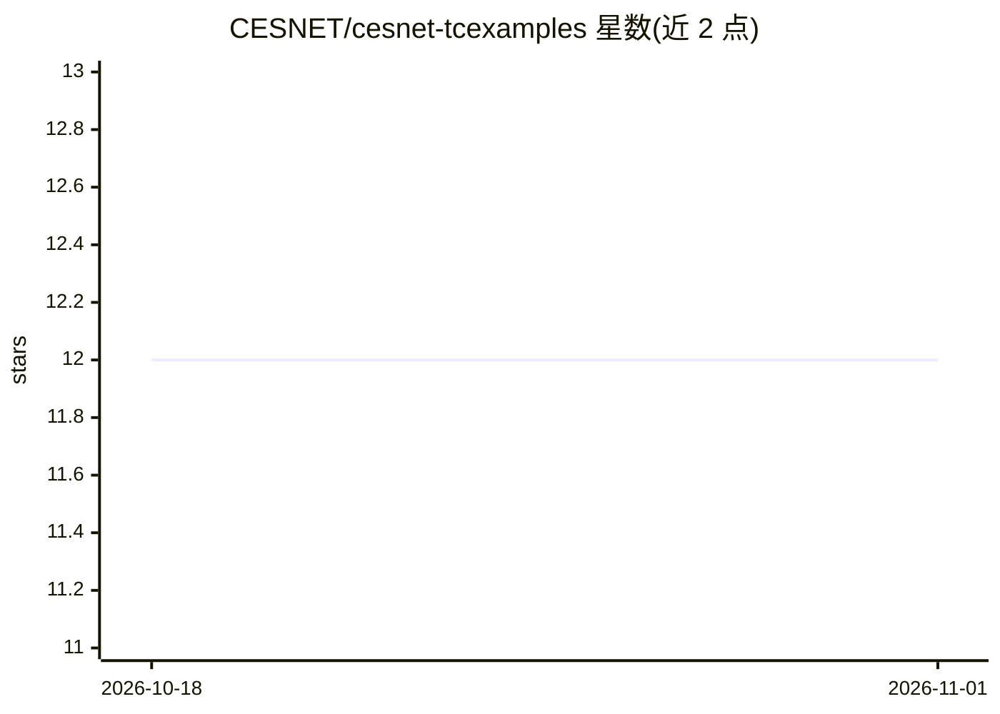

# CESNET/cesnet-tcexamples

⭐ 12 · Jupyter Notebook · 推送 2026-03-17 · [GitHub](https://github.com/CESNET/cesnet-tcexamples) · 组织维护

**流量分类示例 Jupyter 笔记本集合：演示 DataZoo 与 Models 用法**

由 CESNET 维护的 Jupyter 笔记本集合，演示 cesnet-datazoo 与 cesnet-models 两个包的用法：数据探索、LightGBM 训练与按周/日/月评估、使用预训练模型复现 TLS 与 QUIC 加密流量分类论文结果、从零训练神经网络，以及跨十个下游任务的迁移学习实验（k-NN、线性探测、微调）。面向从事加密流量分类的研究者与开发者，依赖通过 requirements.txt 或笔记本首单元格安装，需 PyTorch（CUDA 支持）。

## 筛选速览

| 维度 | 判定 | 备注 |
|---|---|---|
| AI 角色 | `ai-knowledge` | 知识聚合/清单类 |
| 许可风险 | `none` | — |
| 部署形态 | `library` | 以包/库形式分发 |
| 模型依赖 | — | README 未给出锁定关系 |
| 硬件要求 | — | 无带数字的原话,不猜 |
| 安装摩擦 | `medium` | 含编译或系统依赖之一 |
| 成熟度 | — | 结构信号不足 |

## 能力要点

- 覆盖 LightGBM 与神经网络两类训练示例
- 使用预训练模型复现 TLS/QUIC 加密流量分类论文
- 含跨十个下游任务的迁移学习示例（k-NN/线性探测/微调）
- 按周/日/月多粒度评估流程

## 适用场景

- 学习 cesnet-datazoo 数据集与 cesnet-models 的使用方式
- 复现加密流量分类论文的实验结果
- 参考流量分类模型的训练与评估流程

## 场景标签

`微调` `教程课程` · 领域:学习与行业

## 证据(README 行号)

> L2: A collection of Jupyter notebooks with examples of usage of the `cesnet-datazoo` and `cesnet-models` packages.
> L10: - `explore_data.ipynb` - Simple initialization of a dataset class to explore available features.

## 星数曲线

2026-10-18 12 → 2026-11-01 12（+0）

---
*卡片 v1 · prompt 1.4 · 生成 2026-11-01 · 置信度 high · 依据 README sha `340b75adf1fa` · [字段定义](../../DATASET.md)*
