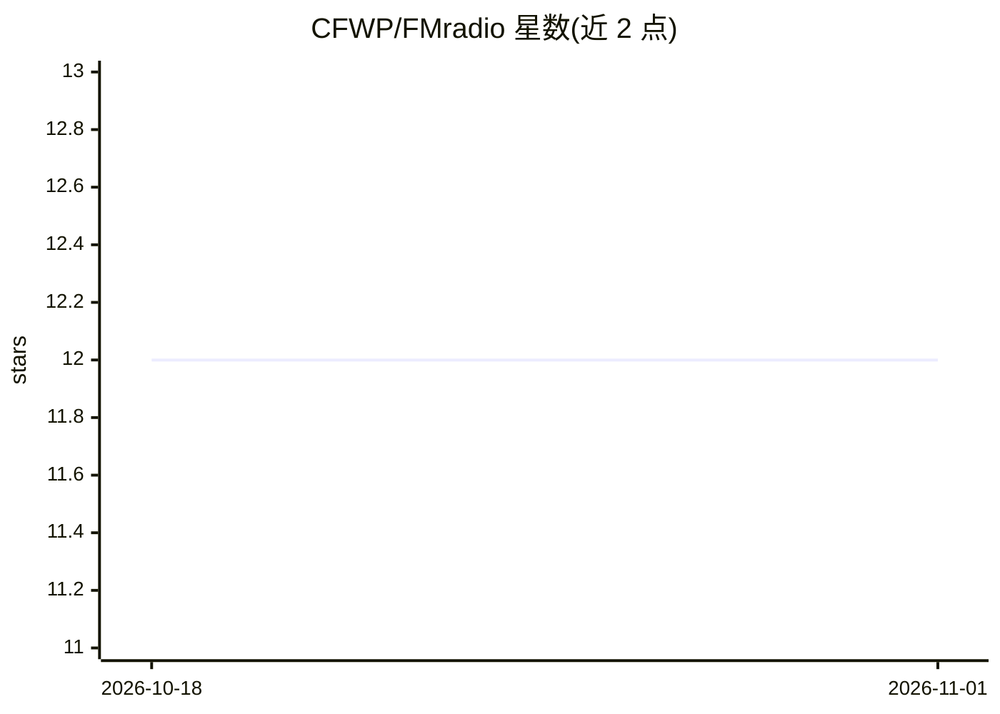

# CFWP/FMradio

⭐ 12 · R · 推送 2026-09-25 · [GitHub](https://github.com/CFWP/FMradio) · 个人维护

**R 包：通过因子分析建模实现影像组学数据的稳定预测与分类**

FMradio 是一个发布于 CRAN 的 R 包，对影像组学（radiomics）数据做因子分析建模，支持稳定预测与分类，且不依赖具体成像模态（MRI、PET、CT 均可）。项目自述处于稳定可用、持续开发状态。安装方式为通过 devtools 从 GitHub 主分支安装（需 R 包开发前置依赖），另有 PDF 手册；配套论文给出模拟与结果复现脚本（arXiv:1903.11696）。

## 筛选速览

| 维度 | 判定 | 备注 |
|---|---|---|
| AI 角色 | `ai-native` | 本体是模型或模型工具 |
| 许可风险 | `none` | — |
| 部署形态 | `None` |  |
| 模型依赖 | — | README 未给出锁定关系 |
| 硬件要求 | — | 无带数字的原话,不猜 |
| 安装摩擦 | `low` | 无编译、无系统依赖或容器化 |
| 成熟度 | — | 结构信号不足 |

## 能力要点

- 对影像组学数据做因子分析建模，支持稳定预测与分类
- 不依赖成像模态（MRI/PET/CT）
- 发布于 CRAN（v1.1.3），提供 PDF 手册与论文复现脚本

## 适用场景

- 对高维影像组学特征做降维建模后进行预测或分类
- 复现 Peeters 等人 2019 年论文中的模拟与结果
- 跨成像模态的影像组学分析流程

## 场景标签

`科研工具` · 领域:学习与行业

## 证据(README 行号)

> L9: The R-package **FMradio** supports stable prediction and classification with radiomics data through factor-analytic 
> L10: This support can be invoked irrespective of the imaging modality (such as, e.g., MRI, PET, CT) used to produce the 

## 星数曲线

2026-10-18 12 → 2026-11-01 12（+0）

---
*卡片 v1 · prompt 1.4 · 生成 2026-11-01 · 置信度 high · 依据 README sha `74d9fb181380` · [字段定义](../../DATASET.md)*
