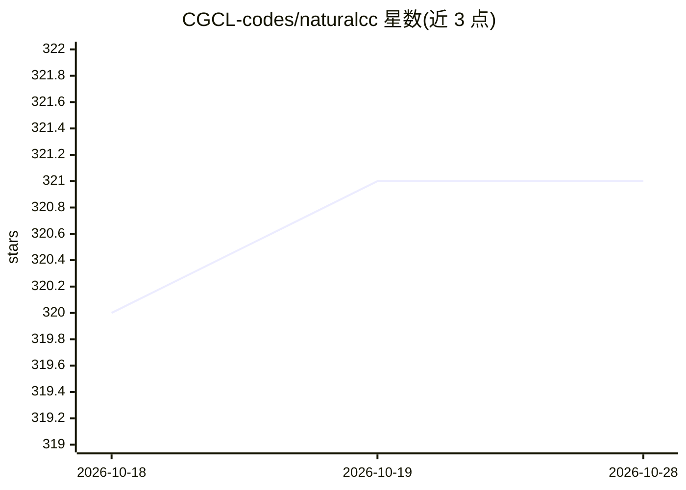

# CGCL-codes/naturalcc

⭐ 321 · Python · MIT · 推送 2026-10-23 · [GitHub](https://github.com/CGCL-codes/naturalcc) · [官网](http://xcodemind.github.io) · 组织维护 · 中文 README

**面向科研者的代码智能工具包：训练/评测代码大模型**

基于 Fairseq 注册机制与 PyTorch 的代码智能序列建模工具包，支持训练自定义模型完成代码生成、补全、摘要、检索、克隆检测与类型推断等软件工程任务。内置 Human-Eval、CodeSearchNet、Py150 等预处理基准数据集，兼容 Transformers 并接入 Code Llama、CodeT5、CodeGen、StarCoder 等大代码模型，提供 pass@k 等评测指标与多 GPU 分布式训练（FP32/FP16）。2.0 版起从源码编译安装，需 GCC≥5.0，GPU/NCCL/CUDA 为可选推荐项。

## 筛选速览

| 维度 | 判定 | 备注 |
|---|---|---|
| AI 角色 | `ai-ecosystem` | LLM/agent 周边工具 |
| 许可风险 | `permissive` | MIT |
| 部署形态 | `library` | 以包/库形式分发 |
| 模型依赖 | — | README 未给出锁定关系 |
| 硬件要求 | — | 无带数字的原话,不猜 |
| 安装摩擦 | `high` | 编译与系统依赖俱全 |
| 成熟度 | — | 结构信号不足 |

## 能力要点

- 支持代码生成/补全/摘要/检索/克隆检测/类型推断等任务的训练与推理
- 内置 Human-Eval、CodeSearchNet、Py150 等基准数据集与评测（pass@k）
- 兼容 Transformers，接入 Code Llama、CodeT5、CodeGen、StarCoder
- NCCL + torch.distributed 多 GPU 训练，支持 FP16

## 适用场景

- 训练或微调代码理解/生成模型
- 在标准基准上评测代码大模型表现
- 用 Code Llama 等模型批量生成代码并导出结果

## 场景标签

`代码生成` `模型评测` `科研工具` `微调` · 领域:编码与开发

## 证据(README 行号)

> L22: NaturalCC is a sequence modeling toolkit designed to bridge the gap between programming and natural languages throu
> L28: - **Support for Large Code Models:** Incorporates state-of-the-art large code models like Code Llama, CodeT5, CodeG
> L29: - **Benchmarking and Evaluation**: Benchmarks multiple downstream tasks (including code generation and code complet

## 星数曲线

2026-10-18 320 → 2026-10-28 321（+1）

---
*卡片 v1 · prompt 1.4 · 生成 2026-10-21 · 置信度 mid · 依据 README sha `5be03763334d` · [字段定义](../../DATASET.md)*
