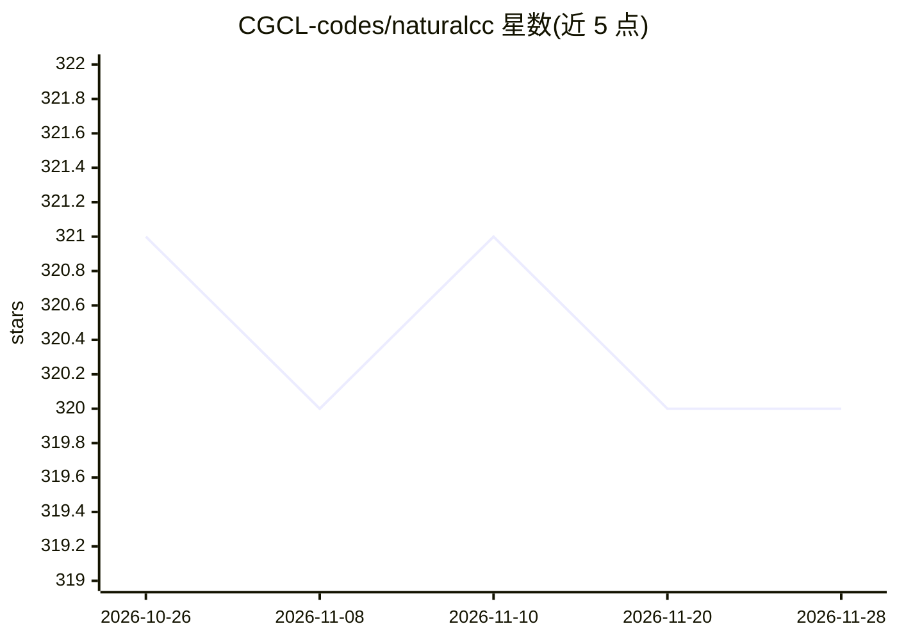

# CGCL-codes/naturalcc

⭐ 320 · C · MIT · 推送 2026-11-24 · [GitHub](https://github.com/CGCL-codes/naturalcc) · [官网](http://xcodemind.github.io) · 组织维护 · 中文 README

**本地运行的上下文感知代码编辑 Agent，含 Web UI/CLI/VS Code 入口**

仓库包含两部分：code_agent 是本地运行的代码编辑 Agent，结合 NaturalCC 静态解析（C/C++ 用 libclang，Java 用 tree-sitter）与 21 个内置工具（文件读写、跑测试、Git 状态、知识图谱检索），提供 Web UI、CLI 与 VS Code 插件三种入口；ncc 为上游代码智能研究工具集（代码解析、模型训练/评估、PEFT）。Agent 模式采用事件溯源（SQLite）实现可审计可恢复，支持上下文压缩、长期记忆（人工确认后 FTS5 检索）、高风险操作人工审批与 Token/成本预算控制。

## 筛选速览

| 维度 | 判定 | 备注 |
|---|---|---|
| AI 角色 | `ai-native` | 本体是模型或模型工具 |
| 许可风险 | `permissive` | MIT |
| 部署形态 | `None` |  |
| 模型依赖 | — | README 未给出锁定关系 |
| 硬件要求 | — | 无带数字的原话,不猜 |
| 安装摩擦 | `low` | 无编译、无系统依赖或容器化 |
| 成熟度 | — | 结构信号不足 |

## 能力要点

- 结合 libclang/tree-sitter 静态解析与 21 个内置工具的上下文感知 Agent
- 事件溯源（SQLite）持久化：每步可审计可恢复，上下文自动压缩与长期记忆
- 安全机制：人工审批、命令白名单/黑名单、敏感路径禁读、结果脱敏
- CodeGraph 知识图谱：符号探索、调用路径、影响分析与交互式可视化

## 适用场景

- 在本地 workspace 用 Agent 完成代码补全、修复与漏洞检测
- 通过知识图谱做代码符号探索与影响分析
- 在 VS Code 内直接调用 Agent 面板编辑代码

## 场景标签

`编码 Agent` `Agent 记忆` `知识图谱` `微调` · 领域:Agent 开发

## 证据(README 行号)

> L7: |`code_agent/`|**开源的主角**：一个上下文感知的本地编码 Agent，提供 Web UI、CLI 和 VS Code 插件三种使用方式|📖 中文教程|
> L26: - **上下文感知**：结合 NaturalCC 静态解析（C/C++ 用 libclang，Java 用 tree-sitter）与 21 个内置工具（读写文件、跑测试、Git 状态、知识图谱检索……），不是通用聊天机器人；

## 星数曲线

2026-10-26 321 → 2026-11-28 320（-1）

---
*卡片 v1 · prompt 1.4 · 生成 2026-11-25 · 置信度 high · 依据 README sha `162f0f3112ee` · [字段定义](../../DATASET.md)*
