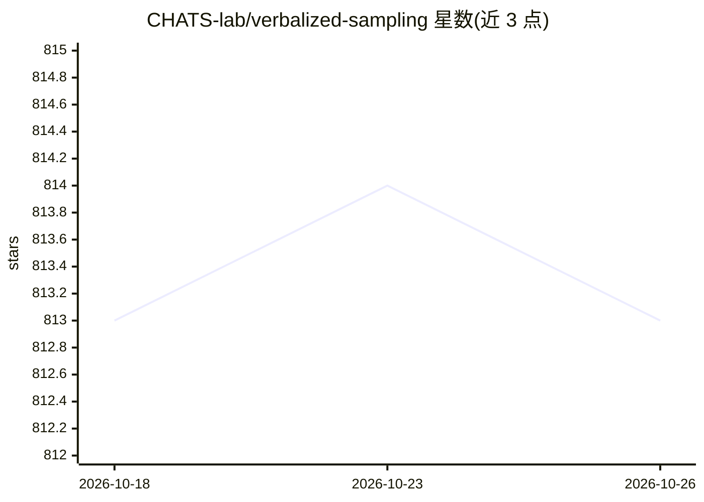

# CHATS-lab/verbalized-sampling

⭐ 813 · Python · NOASSERTION · 推送 2026-01-03 · [GitHub](https://github.com/CHATS-lab/verbalized-sampling) · [官网](https://www.verbalized-sampling.com/) · 组织维护

**缓解 LLM 模式坍缩的免训练提示策略库：让输出多样性提升 2-3 倍**

通过让模型生成多条带自报概率的候选回答、再从该分布中抽样的提示策略，缓解 LLM 输出模式坍缩问题，论文报告多样性提升 2-3 倍且维持质量。免训练、模型无关（GPT/Claude/Gemini/Llama 等），与温度正交。适用任务包括创意写作、社会模拟、合成数据生成与开放式问答。提供 Python 包（pip 安装）、LangChain 集成、Colab 笔记、论文复现脚本及 HF 数据集。Apache 2.0 许可。

## 筛选速览

| 维度 | 判定 | 备注 |
|---|---|---|
| AI 角色 | `ai-native` | 本体是模型或模型工具 |
| 许可风险 | `none` | NOASSERTION |
| 部署形态 | `library` | 以包/库形式分发 |
| 模型依赖 | — | README 未给出锁定关系 |
| 硬件要求 | — | 无带数字的原话,不猜 |
| 安装摩擦 | `low` | 无编译、无系统依赖或容器化 |
| 成熟度 | — | 结构信号不足 |

## 能力要点

- 免训练、模型无关：纯提示即可在任何聊天模型上使用
- 让模型生成带概率的多条回答并从分布抽样，报告 2-3 倍多样性提升
- 提供 Python 包、LangChain 集成与自动抽样函数
- 附论文复现脚本与 HuggingFace 数据集（笑话/开放式 QA/对话模拟等）

## 适用场景

- 创意写作或头脑风暴时获得更多样的模型输出
- 生成多样化的合成数据集
- 对话模拟与社会模拟中降低模型回答趋同

## 场景标签

`提示工程` `AI 写作` · 领域:Agent 开发

## 证据(README 行号)

> L16: **Verbalized Sampling (VS)** is a simple prompting strategy that improves LLM diversity by 2-3x. It works by asking
> L41: For all of the above in a single function call, the ability to automatically sample from the verbalized responses, 

## 星数曲线

2026-10-18 813 → 2026-10-26 813（+0）

---
*卡片 v1 · prompt 1.4 · 生成 2026-10-22 · 置信度 high · 依据 README sha `dc429ff214c3` · [字段定义](../../DATASET.md)*
