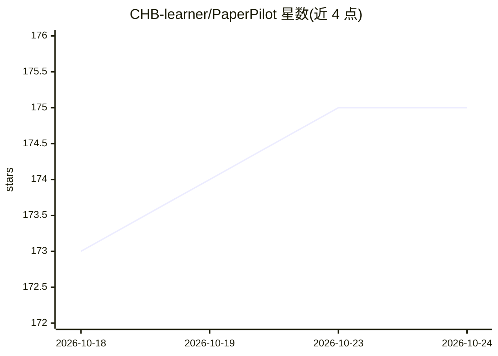

# CHB-learner/PaperPilot

⭐ 175 · Python · MIT · 推送 2026-05-19 · [GitHub](https://github.com/CHB-learner/PaperPilot) · [官网](https://chb-learner.github.io/PaperPilot/) · 个人维护 · 中文 README

**AI 文献综述 CLI Agent：一次请求产出可溯源的中英双语综述报告**

面向科研用户的命令行文献综述代理：解析自然语言研究请求，生成含纳入/排除规则的检索方案，跨 arXiv、Semantic Scholar、OpenAlex、PubMed 等 11 个免费来源检索并去重筛选论文，核验 PDF 与代码仓库链接（不绕过付费墙），下载开放 PDF 并抽取全文，合成证据链后输出 Markdown/HTML/PDF 的中英双语报告，默认生成 Obsidian 知识库导出。需配置 OpenAI 兼容 LLM（示例为 DeepSeek），每次运行在 runs/ 目录留存完整状态与审计日志，支持断点续跑。另有 Cloudflare Workers 在线轻量版。

## 筛选速览

| 维度 | 判定 | 备注 |
|---|---|---|
| AI 角色 | `ai-native` | 本体是模型或模型工具 |
| 许可风险 | `permissive` | MIT |
| 部署形态 | `library` | 以包/库形式分发 |
| 模型依赖 | — | README 未给出锁定关系 |
| 硬件要求 | — | 无带数字的原话,不猜 |
| 安装摩擦 | `low` | 无编译、无系统依赖或容器化 |
| 成熟度 | — | 结构信号不足 |

## 能力要点

- 状态机流水线：Intake→Protocol→Search→Screening→Verification→Synthesis→Report
- 11 个默认免费文献来源 + 7 类可选 API-key 来源
- 证据台账（evidence ledger）与引文合规检查，声明映射到语料证据
- 默认生成 Obsidian Wiki（论文/方法/主题/声明笔记）

## 适用场景

- 输入一句话课题方向，得到带引用编号的结构化文献综述
- 筛出带公开代码仓库的论文并自动核验 PDF 可下载性
- 将综述结果沉淀为 Obsidian 知识库用于长期阅读管理

## 场景标签

`科研工具` `知识库管理` · 领域:知识与检索

## 证据(README 行号)

> L22: PaperPilot is a **CLI research agent for scholarly literature review** across AI, biomedicine, and AI for Science.
> L36: - Synthesize evidence and generate review reports
> L117: PaperPilot requires OpenAI-compatible LLM settings for query understanding, planning, synthesis, and report genera

## 星数曲线

2026-10-18 173 → 2026-10-24 175（+2）

---
*卡片 v1 · prompt 1.4 · 生成 2026-10-23 · 置信度 high · 依据 README sha `998a5d89741d` · [字段定义](../../DATASET.md)*
