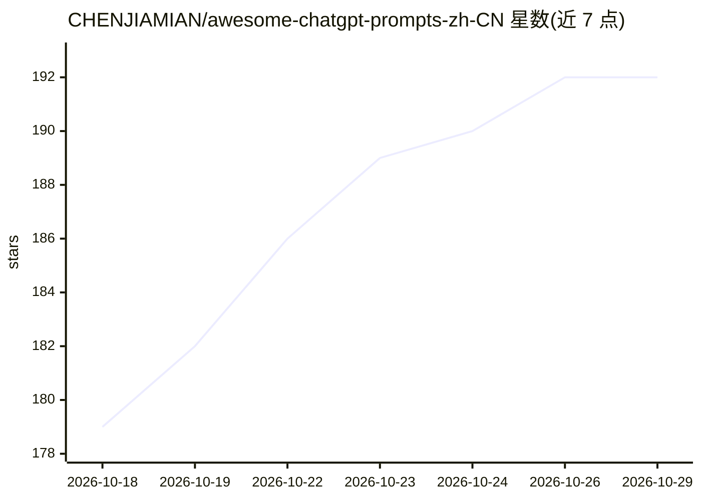

# CHENJIAMIAN/awesome-chatgpt-prompts-zh-CN

⭐ 192 · HTML · CC0-1.0 · 推送 2026-09-25 · [GitHub](https://github.com/CHENJIAMIAN/awesome-chatgpt-prompts-zh-CN) · [官网](https://prompts.chat) · 个人维护 · 中文 README

**ChatGPT 提示词中文翻译合集：2169 条全译 + AIPRM 快照**

把上游 f/prompts.chat（原 awesome-chatgpt-prompts）全部 2169 条提示词（含 3 条历史条目，共 2172 条）翻译为简体中文，整理成 Markdown 索引、CSV、JSON 三种形式；另附 2023 年抓取的 AIPRM 提示词库快照 1536 条及另一份 3652 条标题+摘要清单。中文译文由通义千问模型辅助批量翻译（2026-09 重译），保留 Markdown 结构、代码块与占位符；原文以 prompts.csv 为准逐条对齐，条目质量参差处如实保留未删减。供用户检索提示词、当数据集下载或粘贴到任意对话模型使用。

## 筛选速览

| 维度 | 判定 | 备注 |
|---|---|---|
| AI 角色 | `ai-knowledge` | 知识聚合/清单类 |
| 许可风险 | `viral` | CC0-1.0 |
| 部署形态 | `None` |  |
| 模型依赖 | — | README 未给出锁定关系 |
| 硬件要求 | — | 无带数字的原话,不猜 |
| 安装摩擦 | `low` | 无编译、无系统依赖或容器化 |
| 成熟度 | — | 结构信号不足 |

## 能力要点

- 上游 2169 条提示词全部重译为简体中文，共 2172 条
- 提供 Markdown 索引 / CSV / JSON 多种数据形式
- 附 AIPRM 快照 1536 条与 3652 条标题+摘要清单
- 译文与原文按行序逐条对齐，原文以 prompts.csv 为准

## 适用场景

- 我要找现成的中文提示词直接粘贴给 ChatGPT / Claude 等对话模型
- 把提示词数据集下载下来做分析或接入自己的应用
- 查面向 Midjourney / DALL·E 的图像生成提示词

## 场景标签

`提示工程` `精选清单` · 领域:Agent 开发

## 证据(README 行号)

> L14: **一句话说明**：把上游 f/prompts.chat（原名 `awesome-chatgpt-prompts`，17 万+ stars）的**全部 2169 条提示词**翻译成简体中文，并把全部译文整理成 CSV / JSON
> L34: |PROMPTS.zh-CN.md|**全量中文提示词索引**，正文按体积分卷到 `prompts/part-NN.md`|2172|
> L48: **2）当成数据集用**：

## 星数曲线

2026-10-18 179 → 2026-10-29 192（+13）

---
*卡片 v1 · prompt 1.4 · 生成 2026-10-22 · 置信度 high · 依据 README sha `34784dcb680c` · [字段定义](../../DATASET.md)*
