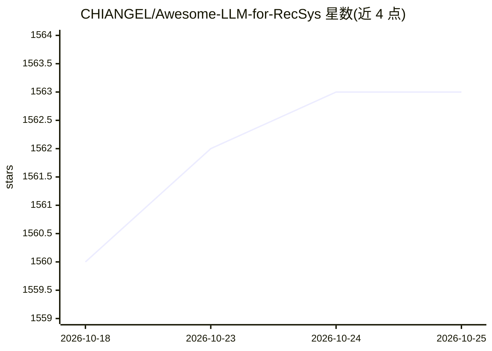

# CHIANGEL/Awesome-LLM-for-RecSys

⭐ 1,564 · MIT · 推送 2026-10-22 · [GitHub](https://github.com/CHIANGEL/Awesome-LLM-for-RecSys) · 个人维护 · 中文 README

**LLM 推荐系统论文与资源清单（附 TOIS 综述）**

收录 LLM 应用于推荐系统（LLM4Rec/LLM4RS）方向的论文与资源的策展清单。配套综述论文被 ACM TOIS 接收，按 LLM 在推荐流程中的介入位置分类组织条目，如特征工程（用户/物品级特征增强、样本生成）、特征编码器（表示增强）等；每条条目标注论文题目、所用 LLM 骨干（含最大规模）、调优策略、发表 venue 与链接。面向推荐系统与 LLM 交叉方向的研究者，README 另提供微信周更论文笔记入口。

## 筛选速览

| 维度 | 判定 | 备注 |
|---|---|---|
| AI 角色 | `ai-knowledge` | 知识聚合/清单类 |
| 许可风险 | `permissive` | MIT |
| 部署形态 | `None` |  |
| 模型依赖 | — | README 未给出锁定关系 |
| 硬件要求 | — | 无带数字的原话,不猜 |
| 安装摩擦 | `low` | 无编译、无系统依赖或容器化 |
| 成熟度 | — | 结构信号不足 |

## 能力要点

- 配套综述论文被 ACM TOIS 接收
- 按 LLM 在推荐流程中的介入位置分类组织论文
- 条目标注 LLM 骨干、调优策略、发表 venue 与链接
- 提供最新研究工作清单与微信周更论文笔记

## 适用场景

- 查找 LLM+推荐系统方向的论文与分类体系
- 跟踪 LLM4Rec 领域最新研究进展
- 撰写相关工作综述时按类别检索文献

## 场景标签

`精选清单` `推荐系统` `科研工具` · 领域:学习与行业

## 证据(README 行号)

> L3: A collection of AWESOME papers and resources on the large language model (LLM) related recommender system topics.
> L5: :tada: Our survey paper has been accepted by **_ACM Transactions on Information Systems (TOIS)_**: How Can Recommend
> L23: We classify papers according to where LLM will be adapted in the pipeline of RS, which is summarized in the figure 

## 星数曲线

2026-10-18 1,560 → 2026-10-25 1,563（+3）

---
*卡片 v1 · prompt 1.4 · 生成 2026-10-21 · 置信度 high · 依据 README sha `e2ed66c082cd` · [字段定义](../../DATASET.md)*
