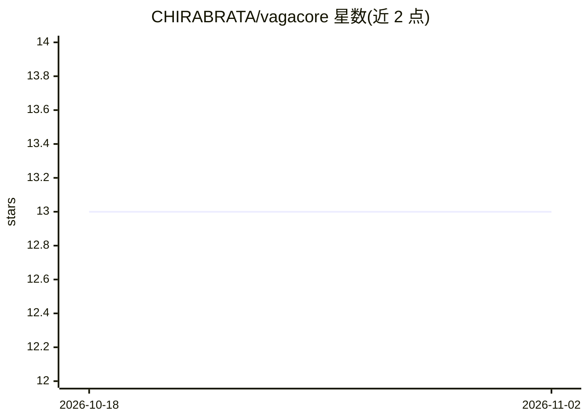

# CHIRABRATA/vagacore

⭐ 13 · HTML · 推送 2026-04-02 · [GitHub](https://github.com/CHIRABRATA/vagacore) · [官网](https://vagacore-documentation.netlify.app/) · 个人维护

**从非结构化文本抽取结构化时间感知事实的 NLP 库**

基于 spaCy 的 Python NLP 流水线：通过 NER、依存句法分析、规则抽取与上下文记忆，把多句非结构化文本转成结构化可查询事实，保留单位与数值精度，跨句传播时间与实体（解决代词与泛指主语），并按规则过滤否定/假设语句、去重合并冲突事实。输出 JSON/Text/LLM 三种格式，无需外部 API，面向 RAG、分析与自动化场景。以 pip 源码方式安装，需 Python 3.8+ 与 spaCy 英文模型。

## 筛选速览

| 维度 | 判定 | 备注 |
|---|---|---|
| AI 角色 | `ai-ecosystem` | LLM/agent 周边工具 |
| 许可风险 | `permissive` | — |
| 部署形态 | `library` | 以包/库形式分发 |
| 模型依赖 | — | README 未给出锁定关系 |
| 硬件要求 | — | 无带数字的原话,不猜 |
| 安装摩擦 | `low` | 无编译、无系统依赖或容器化 |
| 成熟度 | — | 结构信号不足 |

## 能力要点

- 跨句上下文记忆：时间与实体传播，解析代词与泛指主语
- 规则式过滤否定/假设语句，输出确定性、无外部 API
- MONEY/PERCENT/DATE 实体抽取并保留单位（M/B/k/%）
- JSON/Text/LLM 三种输出模式

## 适用场景

- 把金融新闻转成结构化事实供 RAG 检索
- 多句财报文本中提取带时间上下文的数据
- 为下游 LLM 提供压缩后的事实输入

## 场景标签

`文档解析` · 领域:知识与检索

## 证据(README 行号)

> L19: **VagaCore** is a production-ready NLP pipeline that converts unstructured text into structured, queryable facts. B
> L27: - **⚡ Production-Ready**: Deterministic, no external APIs, designed for high-throughput scenarios

## 星数曲线

2026-10-18 13 → 2026-11-02 13（+0）

---
*卡片 v1 · prompt 1.4 · 生成 2026-10-31 · 置信度 high · 依据 README sha `7a26feb6d921` · [字段定义](../../DATASET.md)*
