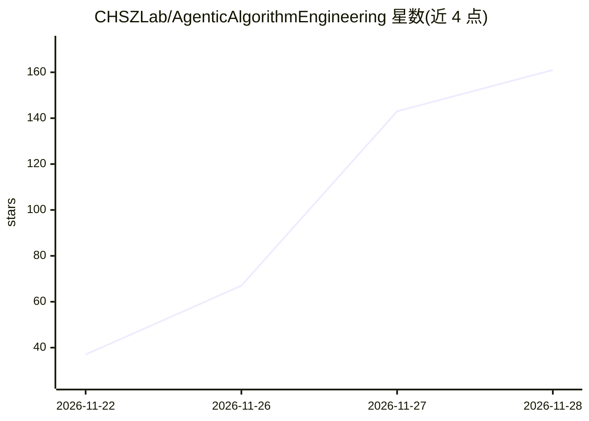

# CHSZLab/AgenticAlgorithmEngineering

⭐ 161 · Python · MIT · 推送 2026-11-27 · [GitHub](https://github.com/CHSZLab/AgenticAlgorithmEngineering) · [官网](https://chszlab.github.io/AgenticAlgorithmEngineering/) · 组织维护

**让自主 agent 按算法工程循环优化代码并产出补丁与 PDF 报告的方法论/技能**

Agentic Algorithm Engineering 是一套方法论及其技能/插件实现：将算法工程循环（设计、分析、实现、实验评估）交给自主 AI agent 执行，每个实验前提出可证伪假设与预测，每次改动后运行正确性断言，接受的改动各生成一个编号 Git 补丁，并输出含指标轨迹与逐假设记录的 PDF 报告。以 Claude Code 插件或 Codex 技能形式安装，附社区贡献的优化知识库；PDF 报告依赖 Python 3 与 LaTeX，无 LaTeX 时仅跳过 PDF。

## 筛选速览

| 维度 | 判定 | 备注 |
|---|---|---|
| AI 角色 | `ai-native` | 本体是模型或模型工具 |
| 许可风险 | `permissive` | MIT |
| 部署形态 | `None` |  |
| 模型依赖 | — | README 未给出锁定关系 |
| 硬件要求 | — | 无带数字的原话,不猜 |
| 安装摩擦 | `low` | 无编译、无系统依赖或容器化 |
| 成熟度 | — | 结构信号不足 |

## 能力要点

- 可证伪假设驱动的实验循环：假设、预测、测量、判定逐条记录
- 每次改动后正确性断言检查，接受改动输出编号 Git 补丁
- 自动生成 PDF 报告（指标轨迹 + 每假设一页）
- 社区知识库沉淀优化经验，支持多组件共享基准模式

## 适用场景

- 对现有代码库中的求解器做自动化性能优化
- 在优化过程中保持输出正确性可验证
- 需要可审查补丁与实验报告的算法研究迭代
- 长耗时系统上用共享基准一次测试多假设

## 场景标签

`编码 Agent` · 领域:编码与开发

## 证据(README 行号)

> L7: This repository contains the program definition for **Agentic Algorithm Engineering (AAE)**, a methodology that turn
> L53: Agentic Algorithm Engineering takes this methodology and hands the cycle to an autonomous AI agent. The agent formu
> L70: |How it runs|an agent prompted with `program.md`|a Python framework calling language models|a skill or plugin in Cl

## 星数曲线

2026-11-22 37 → 2026-11-28 161（+124）

---
*卡片 v1 · prompt 1.4 · 生成 2026-11-27 · 置信度 high · 依据 README sha `af2da1997a37` · [字段定义](../../DATASET.md)*
