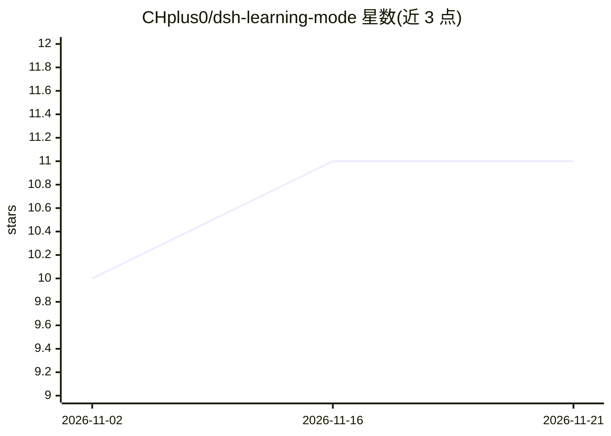

# CHplus0/dsh-learning-mode

⭐ 11 · JavaScript · NOASSERTION · 推送 2026-10-08 · [GitHub](https://github.com/CHplus0/dsh-learning-mode) · 个人维护 · 中文 README

**DeepSeek Harness 学习模式 agent 预设：边写代码边教学**

一个面向 DeepSeek Harness (DSH) 的 agent 预设，仿照 Claude Code 官方 Learning 输出风格，在编码过程中教学。三条支柱：情景化具体讲解（分层深度、按需深入）、引导式思考（先提问、卡住时三级提示阶梯）、留出 `TODO(你)` 练习空白（不涉及安全或正确性关键步骤）。交互上默认教学优先，用户说“直接做”切换为直出模式，开场询问熟悉程度，两次失败后降级为讲解。以 git clone 拷贝或 install.sh 安装，要求 DSH persona 0.1.5-rc.1 以上（prefix schema），旧版 text schema 不支持。

## 筛选速览

| 维度 | 判定 | 备注 |
|---|---|---|
| AI 角色 | `ai-native` | 本体是模型或模型工具 |
| 许可风险 | `none` | NOASSERTION |
| 部署形态 | `library` | 以包/库形式分发 |
| 模型依赖 | locked-api |  |
| 硬件要求 | — | 无带数字的原话,不猜 |
| 安装摩擦 | `low` | 无编译、无系统依赖或容器化 |
| 成熟度 | — | 结构信号不足 |

## 能力要点

- 三支柱教学行为：情景讲解、提问引导、TODO(你) 练习空白
- 提示阶梯 L1→L2→L3 与失败后自动降级为引导讲解
- 输出语言跟随输入语言（中文进中文出）
- 工具集与 DSH 标准 coding agent 相同（Shell/文件/搜索/Skills 等）

## 适用场景

- 在 DSH 编码 agent 中以边做边学的方式理解代码与框架原理
- 通过苏格拉底式提问训练自己的编程思路
- 给初学者配置一个会留练习题而非直接给答案的编码助手

## 场景标签

`编码 Agent` `提示工程` · 领域:Agent 开发

## 证据(README 行号)

> L5: An agent preset for DeepSeek Harness (DSH) that teaches while coding, modeled on Claude Code's official **Learning**
> L25: Requires a DSH deployment using `@deepseek-ai/dsh-persona` `0.1.5-rc.1` or later (`prefix` schema). Older persona v
> L54: - `agent.cordis.yml` is a full copy of the `standard` preset with two changes: the `persona` is replaced with the t

## 星数曲线

2026-11-02 10 → 2026-11-21 11（+1）

---
*卡片 v1 · prompt 1.4 · 生成 2026-11-19 · 置信度 low · 依据 README sha `ffc861b5c121` · [字段定义](../../DATASET.md)*
