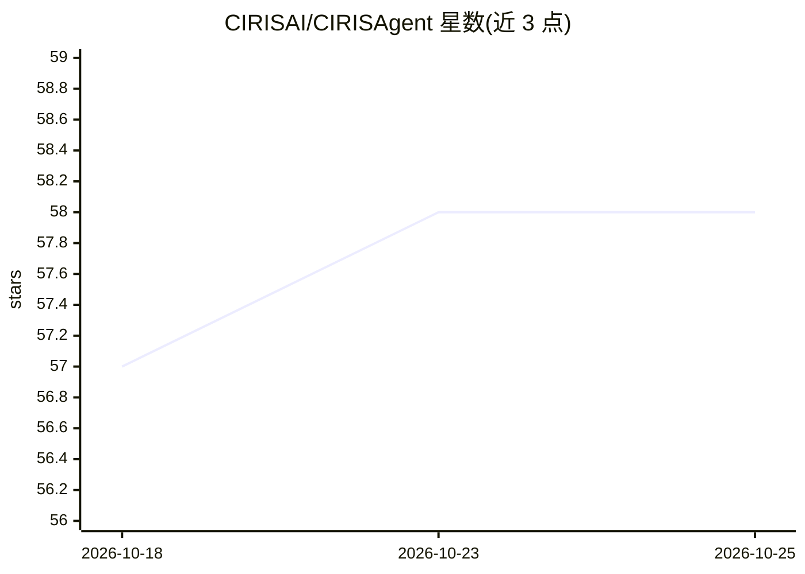

# CIRISAI/CIRISAgent

⭐ 58 · Python · AGPL-3.0 · 推送 2026-10-25 · [GitHub](https://github.com/CIRISAI/CIRISAgent) · [官网](https://ciris.ai) · 个人维护

**可核查推理与人工升级机制的开源 AI 助手**

面向终端用户的聊天助手，同时提供可自托管的开源 AI agent 框架：每条回答经过伦理、常识、领域与推理脆弱性多重检查，不确定时升级给指定人类（Wise Authority），决策写入哈希链防篡改审计轨迹并加密签名，支持 29 种语言。可本地运行，也可用自带 key（OpenAI/Anthropic/Groq/Together.ai/本地模型）或免费托管代理。已用于 Discord 社区审核生产环境；版本 2.x，处于活跃开发早期。提供 pip 安装桌面端/服务器端与 App Store/Google Play 下载。

## 筛选速览

| 维度 | 判定 | 备注 |
|---|---|---|
| AI 角色 | `ai-native` | 本体是模型或模型工具 |
| 许可风险 | `viral` | AGPL-3.0 |
| 部署形态 | `library` | 以包/库形式分发 |
| 模型依赖 | — | README 未给出锁定关系 |
| 硬件要求 | — | 无带数字的原话,不猜 |
| 安装摩擦 | `low` | 无编译、无系统依赖或容器化 |
| 成熟度 | `idea` | |

## 能力要点

- 每条回答经过伦理/常识/领域/推理脆弱性多重检查，推理过程可见
- 不确定决策升级给指定人类（Wise Authority）
- 哈希链防篡改审计轨迹与加密签名决策，AGPL-3.0
- 底层为类型安全的 agent 框架：22 个核心服务、200+ API 端点、10,000+ 测试

## 适用场景

- 需要一个可查看推理过程、可审计的私人 AI 聊天助手
- 在 Discord 社区做生产环境的内容审核
- 开发者基于该框架扩展适配器或嵌入自己的系统

## 场景标签

`Agent 框架` `AI 助手` · 领域:Agent 开发

## 证据(README 行号)

> L16: CIRIS replaces apps like ChatGPT and Grok everywhere you need AI. It's the
> L45: CIRIS wraps every AI response in a reasoning pipeline: multiple evaluation
> L77: Under the consumer app, CIRIS is a type-safe, auditable AI agent framework —

## 星数曲线

2026-10-18 57 → 2026-10-25 58（+1）

---
*卡片 v1 · prompt 1.4 · 生成 2026-10-24 · 置信度 high · 依据 README sha `971bab677c16` · [字段定义](../../DATASET.md)*
