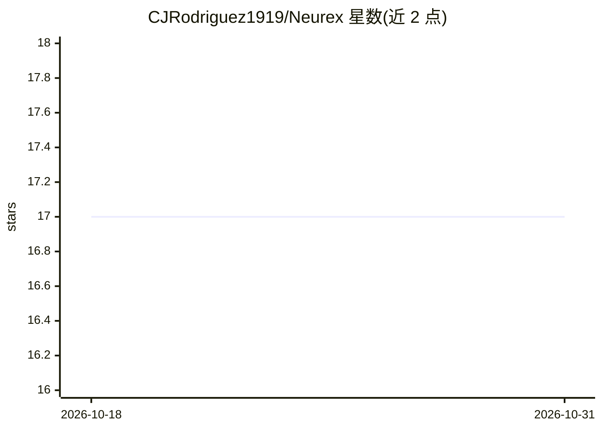

# CJRodriguez1919/Neurex

⭐ 17 · Python · MIT · 推送 2026-05-13 · [GitHub](https://github.com/CJRodriguez1919/Neurex) · [官网](https://neurex.health/) · 个人维护

**消费级 EEG 硬件与上层应用间的脑机接口解码软件栈**

开源脑机接口（BCI）软件栈，定位于消费级 EEG 硬件与应用之间：负责信号处理、特征提取与解码管线，把电极原始采样转为意图输出。支持运动想象（CSP+LDA/FBCSP/黎曼切空间分类器）、注意力、P300、SSVEP、情绪效价等实时解码，配套流式滤波、校准会话、模型注册表、ICA 去伪迹与 OpenBCI/Muse/Crown/Galea/LSL 硬件适配器。以 pip 包形式提供，可无硬件用合成板开发。README 明确声明非医疗器械、非 LLM 项目、1.0 前可能有破坏性变更。

## 筛选速览

| 维度 | 判定 | 备注 |
|---|---|---|
| AI 角色 | `ai-native` | 本体是模型或模型工具 |
| 许可风险 | `permissive` | MIT |
| 部署形态 | `library` | 以包/库形式分发 |
| 模型依赖 | — | README 未给出锁定关系 |
| 硬件要求 | — | 无带数字的原话,不猜 |
| 安装摩擦 | `low` | 无编译、无系统依赖或容器化 |
| 成熟度 | `idea` | |

## 能力要点

- 运动想象/P300/SSVEP/注意力/情绪效价的实时解码管线
- OpenBCI / Muse / Crown / Galea / LSL 硬件适配器
- 无回调单线程管线设计，decisions() 由调用线程驱动
- 合成板（synthetic）模式支持无硬件开发，108 项测试

## 适用场景

- 为 EEG 头环设备搭建意图解码中间层
- 运动想象或 SSVEP 拼写器原型的科研开发
- 无硬件环境下用合成信号调试 BCI 管线

## 场景标签

 · 领域:脑机接口/生物信号处理

## 证据(README 行号)

> L3: Open-source brain-computer interface software stack.
> L21: - Motor imagery (left vs right hand) via CSP+LDA, FBCSP, or Riemannian tangent-space classifiers
> L11: Neurex sits between consumer EEG hardware and your application. It owns

## 星数曲线

2026-10-18 17 → 2026-10-31 17（+0）

---
*卡片 v1 · prompt 1.4 · 生成 2026-10-30 · 置信度 high · 依据 README sha `85f2c62c30fe` · [字段定义](../../DATASET.md)*
