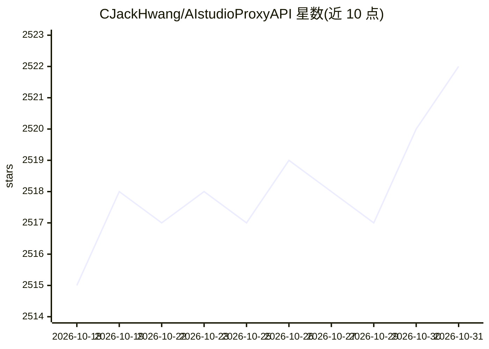

# CJackHwang/AIstudioProxyAPI

⭐ 2,522 · Python · AGPL-3.0 · 推送 2026-04-22 · [GitHub](https://github.com/CJackHwang/AIstudioProxyAPI) · [官网](https://linux.do/u/cjackhwang) · 个人维护 · 中文 README

**将 Google AI Studio 网页转换为 OpenAI 兼容 API 的代理服务**

基于 FastAPI + Playwright + Camoufox 的中间层代理：通过浏览器自动化把 OpenAI 格式的 /v1/chat/completions 请求转发到 Google AI Studio 网页界面，并按 OpenAI 标准格式返回结果。提供函数调用三模式（auto/native/emulated）、认证 profile 自动轮转与 Cookie 周期刷新、CLI/Web UI/桌面 GUI 三种启动方式。要求 Python 3.9+、Poetry、内存 2GB 以上，前端构建需 Node.js。以源码方式安装运行，采用 AGPLv3 许可。

## 筛选速览

| 维度 | 判定 | 备注 |
|---|---|---|
| AI 角色 | `ai-ecosystem` | LLM/agent 周边工具 |
| 许可风险 | `viral` | AGPL-3.0 |
| 部署形态 | `None` |  |
| 模型依赖 | — | README 未给出锁定关系 |
| 硬件要求 | — | 无带数字的原话,不猜 |
| 安装摩擦 | `low` | 无编译、无系统依赖或容器化 |
| 成熟度 | — | 结构信号不足 |

## 能力要点

- OpenAI 兼容 API：/v1/chat/completions 与 /v1/models
- 函数调用三模式 auto/native/emulated，支持失败回退
- 认证 profile 自动轮转、周期刷新与关停保存
- 内置 Web UI 设置页、状态检查与日志面板

## 适用场景

- 把 Google AI Studio 网页接入支持 OpenAI API 的客户端（如 Open WebUI）
- 为已有应用提供 OpenAI 格式接口以调用 AI Studio 模型
- 服务器上以无头模式长期运行代理服务

## 场景标签

`模型网关` · 领域:Agent 开发

## 证据(README 行号)

> L3: 将 Google AI Studio 网页界面转换为 OpenAI 兼容 API 的代理服务。通过 Camoufox + Playwright 自动化，提供稳定可控的 API 访问。
> L9: - **OpenAI 兼容 API**：支持 `/v1/chat/completions`、`/v1/models`

## 星数曲线

2026-10-18 2,515 → 2026-10-31 2,522（+7）

---
*卡片 v1 · prompt 1.4 · 生成 2026-10-21 · 置信度 high · 依据 README sha `bf3119dc5237` · [字段定义](../../DATASET.md)*
