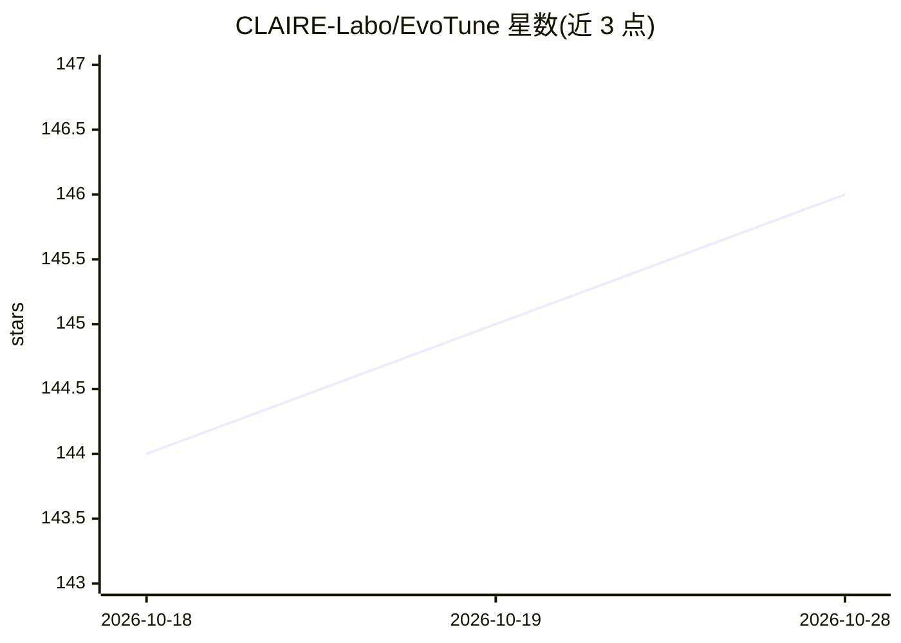

# CLAIRE-Labo/EvoTune

⭐ 146 · Python · MIT · 推送 2025-11-18 · [GitHub](https://github.com/CLAIRE-Labo/EvoTune) · [官网](https://claire-labo.github.io/EvoTune/) · 组织维护

**科研者用 LLM 进化搜索+强化学习发现新算法的框架**

EvoTune 是通过结合两类机制发现新算法的研究框架：对 LLM 生成的 Python 程序做进化搜索，并依据所发现算法的性能分数用强化学习微调搜索算子（即 LLM 本身）。代码位于 src/，采用 Hydra 配置系统，提供 main.py（进化+微调训练）与 eval.py（评估程序库）两个入口及适配 SLURM/RunAI 的扫参脚本。实验环境以 Dockerfile 提供，区分 x86_64/ARM64 与 TGI/vLLM 推理后端，论文多数实验使用 A100 80GB GPU。支持在 src/packing/evaluate/README.md 指引下注册自定义任务；开源为重构后的最新版本，结果可能与论文存在细微差异。

## 筛选速览

| 维度 | 判定 | 备注 |
|---|---|---|
| AI 角色 | `ai-ecosystem` | LLM/agent 周边工具 |
| 许可风险 | `permissive` | MIT |
| 部署形态 | `self-host` | docker 或自建部署 |
| 模型依赖 | local-ok | 支持本地模型 |
| 硬件要求 | — | 无带数字的原话,不猜 |
| 安装摩擦 | `low` | 无编译、无系统依赖或容器化 |
| 成熟度 | — | 结构信号不足 |

## 能力要点

- LLM 生成 Python 程序的进化搜索与基于性能分数的 LLM 强化学习微调
- 提供训练与评估两个入口及 SLURM/RunAI 扫参脚本
- 按机器架构与推理后端（TGI/vLLM）区分的 Dockerfile 环境
- 支持按文档注册自定义优化任务

## 适用场景

- 运行进化+RL 流程发现组合优化问题的算法
- 在集群上用 SLURM 批量扫参复现论文实验
- 注册自己的优化任务并用 LLM 搜索求解程序

## 场景标签

`科研工具` `强化学习` · 领域:学习与行业

## 证据(README 行号)

> L8: **EvoTune** is a framework for discovering new algorithms by combining:
> L10: 1. Evolutionary search over LLM-generated Python programs, and
> L11: 2. Reinforcement Learning to fine-tune the search operator - the LLM - based on performance scores of discovered al

## 星数曲线

2026-10-18 144 → 2026-10-28 146（+2）

---
*卡片 v1 · prompt 1.4 · 生成 2026-10-23 · 置信度 high · 依据 README sha `5f84111a08c3` · [字段定义](../../DATASET.md)*
