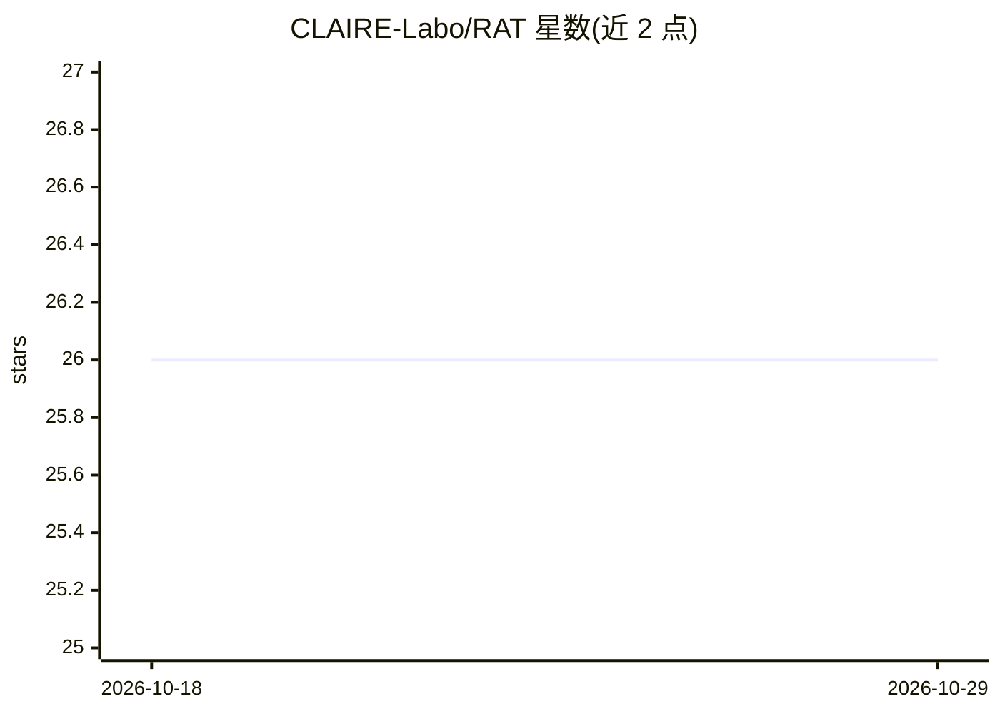

# CLAIRE-Labo/RAT

⭐ 26 · Python · MIT · 推送 2026-08-31 · [GitHub](https://github.com/CLAIRE-Labo/RAT) · [官网](https://claire-labo.github.io/RAT/) · 组织维护

**NeurIPS25 论文 RAT 官方代码：RNN 效率与注意力精度结合的语言建模架构**

RAT（Recurrent Attention with dilated inter-chunk attention）的官方实现：将输入分块，块内用线性递归捕获局部依赖，块间用 softmax 注意力建远程交互，通过调节 chunk 大小在效率与精度间权衡。提供 Dockerfile 环境、100B token 预训练 1.3B 模型的 torchrun 脚本、预训练 checkpoint（Hugging Face），以及 lm-evaluation-harness、LongBench、RULER 等下游评测配置。README 开头即推荐改用后续的 RAT+ 仓库以获得更简代码与更好性能，并说明实现差异。

## 筛选速览

| 维度 | 判定 | 备注 |
|---|---|---|
| AI 角色 | `ai-native` | 本体是模型或模型工具 |
| 许可风险 | `permissive` | MIT |
| 部署形态 | `self-host` | docker 或自建部署 |
| 模型依赖 | — | README 未给出锁定关系 |
| 硬件要求 | — | 无带数字的原话,不猜 |
| 安装摩擦 | `low` | 无编译、无系统依赖或容器化 |
| 成熟度 | — | 结构信号不足 |

## 能力要点

- 块内线性递归 + 块间 softmax 注意力的混合机制
- 从零训练 1.3B 参数模型的完整脚本与 checkpoint
- 覆盖 LongBench、RULER、SFT 等评测的配置文件
- README 推荐后续 RAT+ 仓库作为更新实现

## 适用场景

- 复现论文中 RAT 架构的预训练与评测结果
- 研究 RNN 与注意力混合的高效长上下文架构
- 基于发布的 checkpoint 做下游任务评测

## 场景标签

`模型训练` `模型评测` · 领域:评测与运维

## 证据(README 行号)

> L27: > Transformers have become the cornerstone of modern large-scale language models; however, their dependence on soft
> L52:     torchrun --nnodes=4 --nproc_per_node=4 lm.py experiment=fineweb_edu/attention-xl

## 星数曲线

2026-10-18 26 → 2026-10-29 26（+0）

---
*卡片 v1 · prompt 1.4 · 生成 2026-10-26 · 置信度 high · 依据 README sha `d79c87699ba6` · [字段定义](../../DATASET.md)*
