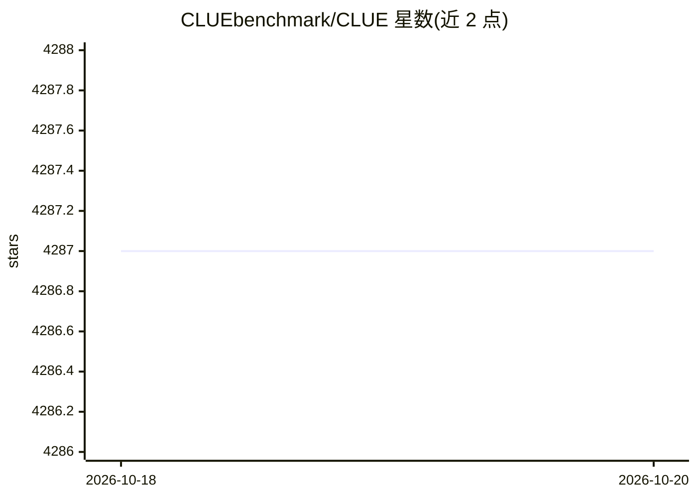

# CLUEbenchmark/CLUE

⭐ 4,287 · Python · 推送 2026-02-06 · [GitHub](https://github.com/CLUEbenchmark/CLUE) · [官网](http://www.CLUEbenchmarks.com) · 组织维护 · 中文 README

**中文语言理解测评基准：数据集、基线模型、语料库与排行榜**

CLUE（Chinese Language Understanding Evaluation benchmark）提供中文 NLU 测评基础设施：收录 AFQMC、TNEWS、IFLYTEK、CMNLI、CLUEWSC2020、CSL、CMRC2018、DRCD、ChID、C3 等约 11 个数据集，覆盖分类、自然语言推理、阅读理解任务；给出 BERT/RoBERTa/ALBERT/ERNIE/XLNet 等基线模型的成绩排行榜（v1 数据集经 k 折交叉验证筛选难样本得到）；附 TensorFlow/PyTorch 基线代码（git clone 后运行脚本，GPU 环境要求 tensorflow 1.12/cuda 9.0/cudnn7.0，也支持 TPU）、PyCLUE 工具包（pip 安装，支持 10 个任务、9 大模型）、14G 预训练语料库 CLUECorpus2020 与诊断集。论文被 COLING2020 录用。

## 筛选速览

| 维度 | 判定 | 备注 |
|---|---|---|
| AI 角色 | `ai-knowledge` | 知识聚合/清单类 |
| 许可风险 | `none` | — |
| 部署形态 | `library` | 以包/库形式分发 |
| 模型依赖 | — | README 未给出锁定关系 |
| 硬件要求 | — | 无带数字的原话,不猜 |
| 安装摩擦 | `medium` | 含编译或系统依赖之一 |
| 成熟度 | — | 结构信号不足 |

## 能力要点

- 约 11 个中文 NLU 数据集，覆盖分类、推理、阅读理解
- BERT/RoBERTa/ALBERT/ERNIE/XLNet 基线模型排行榜与提交测评入口
- PyCLUE 工具包：pip 安装，一行代码运行任务
- CLUECorpus2020 语料库 14G，近 4000 个预训练格式 txt 文件

## 适用场景

- 我要测评自己的中文 NLU 模型并提交排行榜
- 我需要中文分类/推理/阅读理解任务的公开数据集做训练
- 我需要大规模中文语料做预训练或语言建模

## 场景标签

`模型评测` `模型训练` · 领域:评测与运维

## 证据(README 行号)

> L4: 中文语言理解测评基准，包括代表性的数据集、基准(预训练)模型、语料库、排行榜。
> L20: 中文任务测评基准(CLUE benchmark)-排行榜 Leaderboard

## 星数曲线

2026-10-18 4,287 → 2026-10-20 4,287（+0）

---
*卡片 v1 · prompt 1.4 · 生成 2026-10-20 · 置信度 high · 依据 README sha `ed574bb4ed71` · [字段定义](../../DATASET.md)*
